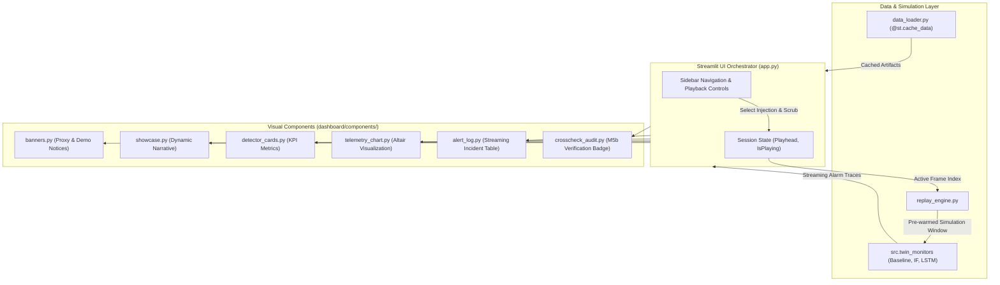

# Dashboard Architecture

The dashboard serves as the human-machine interface (HMI) and interactive demonstration platform for the Cold Chain Early Warning System Digital Twin (Milestone 6.3). It translates complex temporal telemetry streams, discrete-event simulation states, and multi-model anomaly detection horizons into an intuitive, presentation-grade cockpit.

---

## 1. Architectural Philosophy & Design Constraints

The dashboard is built upon strict engineering decisions established across Milestones 5 and 6:

1. **Modular Presentation Layer (D30):** The dashboard is decoupled from the modeling core. All model logic is imported directly from `src/twin_monitors.py`, ensuring zero discrepancy between offline evaluation and UI demonstration.
2. **Deterministic Parity (D27, D33):** The UI runs the exact streaming monitors validated in Milestone 5b. When simulating local replay windows, it applies the **D33 Pre-warming Protocol** (pre-feeding 10 readings for Isolation Forest and 30 readings for LSTM) to eliminate cold-start transient artifacts.
3. **Display-Only Acceleration (D28):** Playback speed factors (`1x`, `5x`, `10x`, `25x`, `Instant`) modify solely client-side tick sleep intervals. Telemetry timestamps, sensor deltas, and feature values are mathematically immutable.
4. **Transparent Governance (D31, D34):** Persistent disclaimers communicate the structural proxy nature of the dataset. Narrative captions and performance metrics are dynamically pulled from `three_way_comparison.csv` and `twin_crosscheck_report.csv`—never hardcoded.
5. **Fail-Fast Startup Integrity (D32):** On initialization, `run_d32_startup_check()` validates the existence and integrity of all required model weights and CSV artifacts before rendering.

---

## 2. Directory & Component Decomposition

The dashboard codebase resides entirely in `dashboard/` and is partitioned into dedicated modular layers:

```text
dashboard/
├── app.py                      # Main entry point & Streamlit page orchestration
├── constants.py                # Visual constants, thresholds, icons, and Guided Tour specs
├── data_loader.py              # Cached I/O loaders, clean baseline stats, D32 verification
├── replay_engine.py            # Local window slicing and D33 pre-warmed simulation runner
└── components/                 # Modular visual presentation blocks
    ├── banners.py              # Structural proxy (D31) and train-side demo disclaimers
    ├── showcase.py             # Guided tour narrative cards and telemetry status bar
    ├── detector_cards.py       # Three-way detector KPI cards (Baseline, IF, LSTM)
    ├── telemetry_chart.py      # Layered Altair telemetry chart and score diagnostics
    ├── alert_log.py            # Filterable live alert log table
    └── crosscheck_audit.py     # Milestone 5b cross-check verification audit badge
```

---

## 3. Component Interaction Diagram



---

## 4. Key Subsystems & Implementation Details

### 4.1. Data Ingestion & Startup Verification (`data_loader.py`)
- **`run_d32_startup_check()`**: Inspects filesystem for 8 critical artifacts:
  - `data/processed/merged_synthetic_injections.csv`
  - `data/processed/three_way_comparison.csv`
  - `data/processed/twin_crosscheck_report.csv`
  - `data/processed/injection_train_test_status.csv`
  - `data/processed/cleaned_out.csv` and `cleaned_in.csv`
  - `models/isolation_forest_model.joblib`
  - `models/lstm_autoencoder.h5`
- **`@st.cache_data` Optimization**: Heavy DataFrames (`cleaned_out.csv`, `cleaned_in.csv`) and metadata tables are cached in memory across reruns to ensure instantaneous scrubbing.

### 4.2. Local Window Replay & Buffer Pre-Warming (`replay_engine.py`)
To visualize an anomaly without re-running all 94,000 readings of the full dataset:
1. Identifies the injection onset timestamp $t_{\text{onset}}$ and search horizon end $t_{\text{horizon\_end}} = t_{\text{end}} + 60\text{ min}$.
2. Slices a temporal window with user-defined padding (default: $\pm 2.0\text{ hours}$).
3. **D33 Pre-warming**: Extracts up to 30 readings immediately preceding the replay window from the historical stream. These readings are fed silently through `IFMonitor` and `LSTMMonitor` without generating alarms.
4. Returns a complete `sim_df` containing historical and injected telemetry, anomaly scores, and alarm flags.

### 4.3. Interactive Visualization Engine (`components/telemetry_chart.py`)
Rendered via **Altair** (declarative Vega-Lite specification):
- **Base Telemetry Trace**: Grey solid line representing `temp_injected` over time.
- **Injection Span**: Semi-transparent orange shaded interval (`[start_ts, end_ts]`).
- **Lead Time Search Horizon**: Semi-transparent purple interval (`[end_ts, end_ts + 60 min]`).
- **Threshold Rule**: Horizontal dashed red line indicating the baseline threshold ($47.67^\circ\text{C}$ for Out, $31.06^\circ\text{C}$ for In).
- **Alarm Marks**:
  - Red triangles: Naive Baseline threshold violations.
  - Green squares: Isolation Forest spatial/rolling outlier alarms.
  - Blue circles: LSTM-Autoencoder temporal reconstruction error alarms.
- **Current Playhead Rule**: Vertical dashed blue line dynamically tracking `sim_df.iloc[current_frame]['ts']`.
- **Score Trajectories (Collapsible Expander)**: Synchronized time-series charts of Isolation Forest decision score ($< 0$ threshold) and LSTM reconstruction MSE ($> \tau_{\text{recon}}$ threshold).

### 4.4. Three-Way Metric Cards (`components/detector_cards.py`)
Displays real-time operational status for each detector:
- **Current Metric**: Instantaneous temperature for Baseline, decision score for IF, and reconstruction error (MSE) for LSTM.
- **Threshold Reference**: Shows exact mathematical tripwire.
- **Lead Time Status Badge**:
  - `Early Warning`: Alarm occurred prior to baseline excursion ($+\Delta t\text{ min}$).
  - `Lagging`: Alarm occurred after baseline ($-\Delta t\text{ min}$).
  - `Baseline Tripped`: Exact moment threshold violated ($0.0\text{ min}$).
  - `Never Fired / Missed`: Detector failed to identify anomaly within the 60-minute post-onset horizon.

---

## 5. User Interaction Modes

### Mode 1: Guided Tour (Viva Showcase)
Designed for live presentations and academic defense. Curates 4 representative test-set injections highlighting key theoretical findings:
1. **Showcase 1 (`out_step_001` - Abrupt Step Failure):** Illustrates the instant detection capabilities of the baseline detector when a catastrophic jump violates threshold boundaries.
2. **Showcase 2 (`out_drift_001` - Incipient Thermal Drift):** Demonstrates **64.0 minutes** of early warning lead time achieved by Isolation Forest before static threshold excursion.
3. **Showcase 3 (`out_flatline_001` - Sensor Malfunction / Flatline):** Highlights zero-variance freezing within normal operating temperatures ($41.0^\circ\text{C}$), completely invisible to threshold detectors.
4. **Showcase 4 (`in_drift_001` - In-Series Sequence Reconstruction):** Demonstrates LSTM-Autoencoder lead time advantage in indoor ambient environments.

### Mode 2: Free Explore
Allows full exploration of all 30 synthetic injections:
- Filter by Series (`All`, `Out`, `In`).
- Replay Window Padding slider ($\pm 0.5$ to $\pm 6.0\text{ hours}$).
- Explicit visual badges differentiating `TEST` injections from `TRAIN DEMO` injections.

---

## 6. Playback Control Loop & Session State

Streamlit operates on an event-driven execution model. Continuous playback is managed via session state and reactive rerun triggers:

```python
# Playhead session state keys
session_key = f"playhead_{selected_inj_id}"
is_playing_key = f"is_playing_{selected_inj_id}"

# Auto-Play execution loop
if st.session_state.get(is_playing_key, False):
    if st.session_state[session_key] < total_frames - 1:
        st.session_state[session_key] += 1
        time.sleep(delay_for_speed_factor)
        st.rerun()
    else:
        st.session_state[is_playing_key] = False
        st.rerun()
```

This architecture provides responsive frame-by-frame scrubbing via the timeline slider alongside smooth automated playback.

