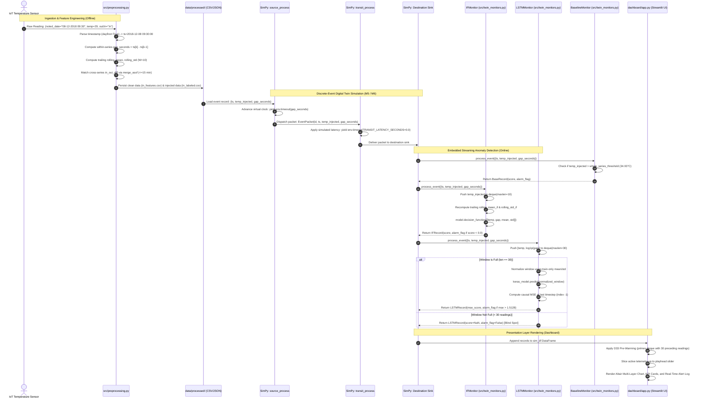

# Data Flow and Lifecycle Architecture

> **Single Source of Truth:** `Context/ARCHITECTURE/DATA_FLOW.md`  
> **Related Documents:**  
> - [`SYSTEM_ARCHITECTURE.md`](SYSTEM_ARCHITECTURE.md)  
> - [`DIGITAL_TWIN_ARCHITECTURE.md`](DIGITAL_TWIN_ARCHITECTURE.md)  
> - [`../DATA/DATA_PREPROCESSING.md`](../DATA/DATA_PREPROCESSING.md)  
> - [`../DATA/DATA_DICTIONARY.md`](../DATA/DATA_DICTIONARY.md)

---

## 1. End-to-End Data Transformation Pipeline

The data transitions through eight distinct states across its lifecycle:

```text
[Raw IOT-temp.csv] (97,606 rows)
       │
       ▼ (dayfirst=True parsing, drop 1 duplicate)
[Clean Deduplicated Stream] (97,605 rows)
       │
       ▼ (Series Splitting: D2)
┌─────────────────────────────────┴─────────────────────────────────┐
│ Out Series (77,260 rows)                                          │ In Series (20,345 rows)
▼                                                                   ▼
[Within-series gap_seconds, rolling stats, cross-series in_out_diff]
│                                                                   │
▼                                                                   ▼
[out_features.csv] (Clean Frozen Baseline)                          [in_features.csv] (Clean Frozen Baseline)
│                                                                   │
▼ (Additive Synthetic Injections: Seed 42, D3)                     ▼
[out_labeled.csv] (30 Injections Cataloged)                         [in_labeled.csv] (30 Injections Cataloged)
│                                                                   │
▼ (Chronological 70/30 Split: cutoff_ts = 2018-10-29 11:10:48, D6)  ▼
┌─────────────────────────────────┴─────────────────────────────────┐
│ Train Split (ts < cutoff_ts)                                      │ Test Split (ts >= cutoff_ts)
│ (24 Injections / Demo Only)                                       │ (6 Injections / Scientific Benchmark)
▼                                                                   ▼
[Model Training & Baseline Calibration]                             [Out-of-Sample Anomaly Scoring]
• IF fitted on train rolling features (D5, D7)                      • IF decision scores & PR curves
• LSTM trained on normalized windows (D9-D12)                       • LSTM causal last-step MSE scores
│                                                                   │
└─────────────────────────────────┬─────────────────────────────────┘
                                  ▼
[SimPy Digital Twin Discrete-Event Replay Engine]
• Source Process: advances virtual clock using gap_seconds (D18)
• Transit Process: models network latency (0.0s pass-through, D19)
• Destination Sink: feeds online streaming monitors (D23, D27)
                                  │
                                  ▼
[Live Streamlit Dashboard Presentation Layer]
• D33 Buffer Pre-Warming (primes 10 IF / 30 LSTM readings)
• Active Telemetry Slicing & Real-Time Alert Logging
• Interactive Altair Telemetry & Anomaly Score Trajectories
```

---

## 2. Sequence Diagram: A Telemetry Reading Traveling Through the System

The following sequence diagram illustrates the lifecycle of a single incoming telemetry event traveling through the physical sensor abstraction, preprocessing, digital twin simulation, and presentation layers:



---

## 3. Data Ingestion & Transformation Details

### 1. Ingestion Stage
* **Raw CSV File:** `data/raw/IOT-temp.csv` (97,606 rows, 5 columns: `id`, `room_id/id`, `noted_date`, `temp`, `out/in`).
* **Format Quirk:** `noted_date` is formatted as `DD-MM-YYYY HH:MM`. 
* **Correction Rule:** Standard Pandas `pd.to_datetime` without `dayfirst=True` causes silent conversion of all days $> 12$ into `NaT` (affecting 47,662 rows, or 48.83% of the dataset). Specifying `dayfirst=True` resolves 100% of timestamps.
* **Deduplication:** Exactly 1 duplicate row is dropped:
  ```text
  id: __export__.temp_log_196108_4a983c7e | Room Admin | 08-12-2018 09:25 | 42 | Out
  ```
  Resulting stream contains exactly **97,605 unique rows**.

### 2. Series Splitting (D2)
Because the outdoor temperature is subject to direct solar radiation and weather swings while the indoor room is climate-controlled, interleaving them creates artificial zero-gap timestamps and distorts variance. They are separated into two distinct files:
* `out_features.csv`: 77,260 rows ($79.16\%$).
* `in_features.csv`: 20,345 rows ($20.84\%$).

### 3. Feature Generation
Within each independent series, time difference is computed:
$$\Delta t_k = t_k - t_{k-1} \quad (\text{stored as }\texttt{gap\_seconds})$$
Rolling statistics are computed over consecutive reading counts:
$$\mu_{\text{roll}, k} = \frac{1}{W} \sum_{i=0}^{W-1} T_{k-i}, \quad \sigma_{\text{roll}, k} = \sqrt{\frac{1}{W-1} \sum_{i=0}^{W-1} (T_{k-i} - \mu_{\text{roll}, k})^2}$$
where $W = 10$ (`ROLLING_WINDOW`).

Cross-series differential is joined via nearest-neighbor timestamp matching:
$$\text{in\_out\_diff}_k = T_{\text{target}, k} - T_{\text{other}, \text{nearest}}$$
If $|t_{\text{target}, k} - t_{\text{other}, \text{nearest}}| > 15\text{ minutes}$, the diff is assigned `NaN`.

---

## 4. The Synthetic Perturbation Data Flow

When synthetic perturbations are generated by `src/anomaly_injection.py`:
1. Clean feature DataFrames are loaded into memory and **copied** (`df_clean.copy()`).
2. An audit catalog (`injection_log.csv`) is initialized.
3. For each of the 30 injections, the perturbation is applied additively:
   * **Step:** $T_{\text{injected}}[t] = T[t] + \text{magnitude}$
   * **Drift:** $T_{\text{injected}}[t] = T[t] + \text{ramp}[t]$
   * **Flatline:** $T_{\text{injected}}[t] = T[t_{\text{start}} - 1]$
4. Binary ground-truth labels are created:
   * `is_injected_anomaly`: `True` for perturbed timestamps, `False` elsewhere.
   * `injection_id`: String identifier (e.g., `"out_drift_009"`).
5. Clean files are left pristine on disk; perturbed data is written to `out_labeled.csv` and `in_labeled.csv`.

---

## 5. Streaming Playback & Pre-Warming Data Flow (D33)

In the interactive dashboard, jumping to an arbitrary anomaly window requires strict memory priming:

```text
[Historical Telemetry Stream]
 ├── [Pre-Warm Range: win_start_idx - 30 to win_start_idx] ──> Fed silently to LSTM / IF deques (No alarms emitted)
 └── [Visible Window: win_start_idx to win_end_idx]       ──> Rendered on UI with exact live alarm matching
```

1. **Pre-Warm Phase:** The replay engine slices the preceding 10 readings for IF and 30 readings for LSTM. It calls `.process_event()` on each monitor. Any generated alarm records are purged via `.alarm_records.clear()`.
2. **Replay Phase:** The visible window rows are streamed sequentially. Because internal rolling buffers are already primed, the detectors produce exact, bit-for-bit identical outputs to the continuous 133-day simulation.

