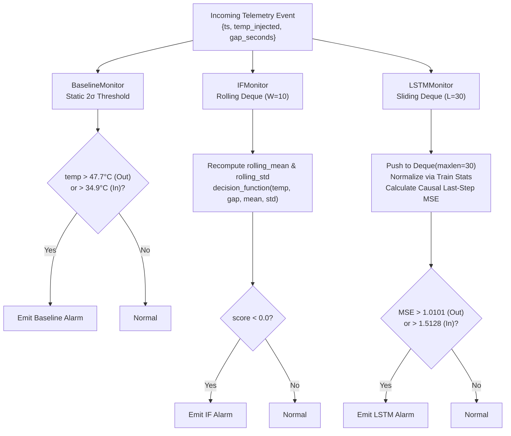

# Digital Twin Architecture & Simulation Mechanics

> **Single Source of Truth:** `Context/ARCHITECTURE/DIGITAL_TWIN_ARCHITECTURE.md`  
> **Related Documents:**  
> - [`SYSTEM_ARCHITECTURE.md`](SYSTEM_ARCHITECTURE.md)  
> - [`DATA_FLOW.md`](DATA_FLOW.md)  
> - [`../DIGITAL_TWIN/SIMULATION_ENGINE.md`](../DIGITAL_TWIN/SIMULATION_ENGINE.md)  
> - [`../DIGITAL_TWIN/STREAMING_MONITORS.md`](../DIGITAL_TWIN/STREAMING_MONITORS.md)  
> - [`../DIGITAL_TWIN/VERIFICATION_AND_PARITY.md`](../DIGITAL_TWIN/VERIFICATION_AND_PARITY.md)

---

## 1. Digital Twin Simulation Philosophy

In physical supply chains, temperature sensors do not emit readings at perfectly synchronized 60-second intervals. Wireless IoT networks suffer from battery saver sleep modes, vehicle ignition cutoffs, carrier handoff delays, and signal dropouts across rural corridors.

To model this operational reality faithfully, this project implements a **discrete-event digital twin** using Python's `simpy` framework (Milestones 5a and 5b, Architectural Decisions D17, D18, D19):

```text
┌─────────────────────────────────────────────────────────────────────────────┐
│                          SimPy Simulation Domain                            │
│                                                                             │
│   [Source Process] ───(Packet Queue)───> [Transit Process] ───(Sink)───>   │
│    Virtual Clock:                         Pass-through:        [Destination]│
│    Advances by gap_seconds                Latency = 0.0s        Monitors:   │
│                                                                 • Baseline  │
│                                                                 • IF        │
│                                                                 • LSTM      │
└─────────────────────────────────────────────────────────────────────────────┘
```

---

## 2. The 3-Stage Data Pipeline Abstraction (D17)

A crucial architectural caveat established in Decision D17 is that the 3-stage pipeline represents a **software data pipeline**, NOT a physical supply chain route (e.g., warehouse $\rightarrow$ truck $\rightarrow$ clinic):
* **Why?** The underlying Kaggle IoT dataset originates from a single room (`room_id/id = "Room Admin"` across all 97,605 rows). It contains no GPS coordinates or multi-facility transitions.
* **The 3 Stages Defined:**
  1. **Stage 1 — Source Process:** Simulates sensor hardware reading generation. Reads the historical telemetry stream row-by-row and emits event packets into the simulation environment.
  2. **Stage 2 — Transit Process:** Models network transmission latency between remote telemetry units and the cloud dispatch server. In baseline experiments, `TRANSIT_LATENCY_SECONDS = 0.0` (D19) to preserve exact batch cross-check parity.
  3. **Stage 3 — Destination Process:** The receiving cloud sink. Houses the logging engine and the three online streaming monitors (`BaselineMonitor`, `IFMonitor`, `LSTMMonitor`).

---

## 3. Event-Driven Virtual Clock Mechanics (D18)

Rather than using continuous time steps or wall-clock pacing (`time.sleep()`), the digital twin operates on an **event-driven virtual clock** (`simpy.Environment`):

### Virtual Clock Progression
1. The Source process retrieves the precomputed within-series arrival difference:
   $$\Delta t_k = \texttt{gap\_seconds}_k = t_k - t_{k-1}$$
2. The process schedules its next arrival by yielding a SimPy timeout:
   ```python
   yield env.timeout(gap_seconds)
   ```
3. SimPy's scheduler jumps `env.now` forward by exactly `gap_seconds` instantaneously.
4. The event packet is dispatched to Transit, which forwards it to Destination.

### Performance & Fidelity Benchmarks
* **133 Days in 6 Seconds:** Replaying 97,603 readings (77,259 on Out, 20,344 on In) spanning 133 continuous calendar days takes only **6.03 seconds of CPU execution** ($>1.9\text{ million}\times$ speedup over real-world time).
* **Zero Clock Drift:** Across all 97,603 rows, the difference between virtual simulation time (`sim_time_received`) and real elapsed dataset time (`delta_real = (ts - ts_0).total_seconds()`) is **$0.00\text{ s}$**, confirming mathematically perfect temporal synchronization.

---

## 4. Replay Semantics: As-Observed Telemetry (D5, D18)

The digital twin replays the **`temp_injected`** column—never the unperturbed `temp` column. 

This mirrors true operational logistics: a monitoring server receives the physical temperature as perturbed by real-world events (doors opening, cooling failing, sensors freezing). Feeding `temp_injected` ensures that the digital twin experiences the exact same sensor noise and disruption profiles that a live production monitoring system would encounter.

---

## 5. Streaming Monitors Inside the Destination Sink (D27)

When an event reaches the Destination sink, it is evaluated in parallel by three online monitors:



### Continuous Memory Buffering (D23)
In the live digital twin, detector deques accumulate **continuously** across the entire 133-day simulation. Buffers are never artificially purged at academic train/test boundaries. Live scoring begins as soon as the first window fills (reading 1 for IF; reading 29 for LSTM) and continues unbroken.

---

## 6. Verification and Batch Parity (Milestone 5b)

To prove that the digital twin introduces no silent bugs, timing discrepancies, or state corruption, Milestone 5b executed an exhaustive cross-check (`src/twin_crosscheck.py`):
* **42 Applicable Evaluations:** Across all 30 synthetic injections and 3 detectors, all 42 valid evaluations matched offline batch calculations **100% bit-for-bit (0 mismatches)**.
* **48 Demo-Only Evaluations:** The 24 train-side injections for IF and LSTM were correctly logged as `not_applicable` (training preview only, D26).
* **Buffer Pre-Warming (D33):** Enabled seamless sub-window replays in the Streamlit UI without cold-start false alarms.

