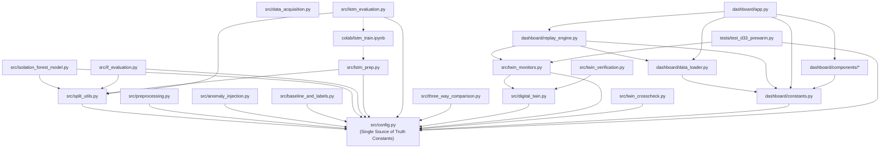

# Module Dependencies and Coupling Boundaries

> **Single Source of Truth:** `Context/ARCHITECTURE/MODULE_DEPENDENCIES.md`  
> **Related Documents:**  
> - [`SYSTEM_ARCHITECTURE.md`](SYSTEM_ARCHITECTURE.md)  
> - [`REPOSITORY_STRUCTURE.md`](REPOSITORY_STRUCTURE.md)  
> - [`../DEVELOPMENT/ENVIRONMENT_SETUP.md`](../DEVELOPMENT/ENVIRONMENT_SETUP.md)  
> - [`../DEVELOPMENT/CODING_CONVENTIONS.md`](../DEVELOPMENT/CODING_CONVENTIONS.md)

---

## 1. Architectural Coupling Principles

The codebase enforces a strict unidirectional dependency hierarchy to prevent circular imports, code duplication, and silent state corruption:

1. **`src/config.py` is the Root Anchor:** All global parameters, window lengths, heuristics, and seeds reside exclusively in `src/config.py`. No other module may define or redefine these constants.
2. **Unidirectional Downstream Consumption:**
   * `src/` modules import only from `src/config.py` and lower-level utilities (`src/split_utils.py`).
   * `dashboard/` consumes `src/twin_monitors.py` and `src/config.py`. It never exports code back to `src/`.
   * `tests/` consumes `src/` modules. Production code never imports from `tests/`.
3. **Zero Logic Duplication in UI (D27):** The Streamlit presentation layer contains no standalone anomaly detection or threshold calculation routines. All algorithms are executed directly via `src.twin_monitors`.

---

## 2. Module Dependency Graph



---

## 3. Package Inventory & External Dependencies

The project environment is managed via [`requirements.txt`](../../requirements.txt). Every external dependency serves a specific, documented architectural role:

| Package Category | Library & Pinned Version | Architectural Role & Justification |
| :--- | :--- | :--- |
| **Core Scientific Computing** | `pandas>=2.0.0` | High-performance time-series manipulation, `dayfirst=True` parsing, causal rolling windows, and `merge_asof` cross-series matching. |
| | `numpy>=1.26.0` | Multi-dimensional matrix transformations, random seed management (`Seed 42`), sliding window extraction, and vector distance math. |
| | `scipy>=1.12.0` | Statistical calculations, cumulative distributions, and dispersion metrics. |
| **Machine Learning & Deep Learning** | `scikit-learn>=1.3.0` | Implementation of `IsolationForest`, `StandardScaler`, and evaluation metrics (`precision_recall_curve`, `auc`, `confusion_matrix`). |
| | `joblib>=1.3.0` | High-performance binary serialization and deserialization of fitted Isolation Forest models and pipelines. |
| | `tensorflow>=2.15.0` | Deep sequence modeling using Keras (`LSTM`, `RepeatVector`, `TimeDistributed`, `Dense`) and `.h5` model weights execution. |
| **Discrete-Event Digital Twin** | `simpy>=4.1.0` | Event-driven simulation framework managing the asynchronous virtual timeline, inter-arrival gap delays, and queue processing. |
| **Dataset Ingestion** | `kagglehub>=0.2.0`<br>`kaggle>=1.6.0` | Programmatic, authenticated dataset downloading from the Kaggle API. |
| **Interactive Dashboard & Viz** | `streamlit>=1.33.0` | Reactive Python web framework powering the presentation layer, Guided Tour showcases, and cloud deployment. |
| | `altair>=5.0.0` | Declarative, tooltipped multi-layer time-series visualization engine for telemetry and anomaly score trajectories. |
| | `matplotlib>=3.8.0`<br>`seaborn>=0.13.0` | Static publication-grade figure generation for academic reports and LaTeX deliverables. |
| **Environment & Quality** | `python-dotenv>=1.0.0` | Secure local configuration and environment variable loading (`.env`). |
| | `ruff>=0.4.0` | High-speed Python linter and formatter enforcing strict PEP-8 standards. |
| **Prototyping & Notebooks** | `jupyter>=1.0.0`<br>`ipykernel>=6.29.0` | Interactive exploratory analysis, development scratchpads, and Colab GPU notebook execution. |

---

## 4. Module Inter-Call Contracts

### 1. `src/twin_monitors.py` Contract
* **Callable Classes:** `BaselineMonitor`, `IFMonitor`, `LSTMMonitor`.
* **Universal Method Signature:**
  ```python
  def process_event(self, event: dict[str, Any]) -> dict[str, Any]:
      """
      Consumes:
          event = {"ts": pd.Timestamp, "temp_injected": float, "gap_seconds": float}
      Produces:
          record = {
              "ts": pd.Timestamp,
              "score": float,       # Raw anomaly score / MSE / temp
              "alarm": bool,        # True if score crosses decision boundary
              "threshold": float,   # Static or calibrated decision limit
          }
      """
  ```
* **Internal Invariant:** Detectors manage their own rolling deques. Calling `.process_event()` appends the reading, updates state, and returns the instantaneous classification flag.

### 2. `dashboard/replay_engine.py` Contract
* **Primary Function:** `simulate_prewarmed_window(series_name, win_start_idx, win_end_idx) -> pd.DataFrame`
* **Internal Behavior:**
  1. Instantiates `BaselineMonitor`, `IFMonitor`, and `LSTMMonitor`.
  2. Slices preceding 10 (IF) and 30 (LSTM) readings.
  3. Pre-warms monitors silently.
  4. Clears alarm records (`.alarm_records.clear()`).
  5. Processes visible window readings sequentially and returns an evaluated DataFrame.

