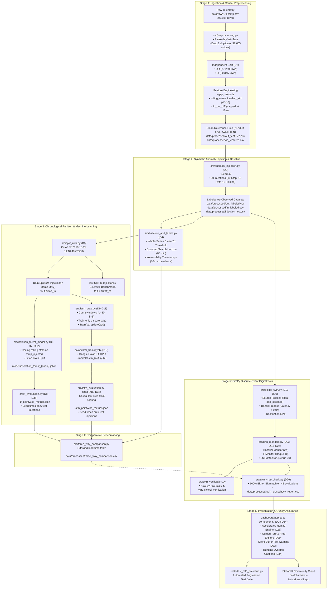

# System Architecture

> **Single Source of Truth:** `Context/ARCHITECTURE/SYSTEM_ARCHITECTURE.md`  
> **Related Documents:**  
> - [`REPOSITORY_STRUCTURE.md`](REPOSITORY_STRUCTURE.md)  
> - [`DATA_FLOW.md`](DATA_FLOW.md)  
> - [`MODULE_DEPENDENCIES.md`](MODULE_DEPENDENCIES.md)  
> - [`DIGITAL_TWIN_ARCHITECTURE.md`](DIGITAL_TWIN_ARCHITECTURE.md)  
> - [`DASHBOARD_ARCHITECTURE.md`](DASHBOARD_ARCHITECTURE.md)  
> - [`../MANAGEMENT/ARCHITECTURAL_DECISIONS.md`](../MANAGEMENT/ARCHITECTURAL_DECISIONS.md)

---

## 1. Architectural Philosophy

The Cold Chain Early Warning System (Digital Twin) is architected around five core engineering principles:

1. **Strict Temporal Causality:** No future information may ever leak into past computations. All rolling features, normalization scaling, and windowing operate with strict backwards-looking time discipline ($t - k \rightarrow t$).
2. **Zero Ingestion Resampling (D1):** The system processes real observed sensor events rather than interpolating onto artificial uniform time grids.
3. **Decoupled 3-Stage Pipeline (D17):** The digital twin abstracts data transmission into formal stages (`Source` $\rightarrow$ `Transit` $\rightarrow$ `Destination`) with clean separation of concerns.
4. **Single Source of Truth (D34, D35):** Quantitative metrics, confusion matrix counts, and alarm timestamps are serialized once into machine-readable JSON/CSV artifacts. Presentation and documentation layers interpolate dynamically without hardcoding numbers.
5. **Bit-for-Bit Live/Batch Parity (D33):** The online streaming monitors embedded in the simulation loop must reproduce offline batch evaluation results identically.

---

## 2. End-to-End System Block Diagram

---

## 3. Structural Decomposition of System Stages

### Stage 1: Ingestion & Causal Preprocessing
* **Primary Script:** [`src/preprocessing.py`](../../src/preprocessing.py)
* **Input:** `data/raw/IOT-temp.csv` (97,606 rows).
* **Processing:**
  1. Parses timestamps with `dayfirst=True` (preventing silent conversion of 47,662 rows to NaT).
  2. Drops 1 exact duplicate, yielding 97,605 unique physical records.
  3. Decouples data into two independent time series: `Out` (77,260 rows) and `In` (20,345 rows).
  4. Generates within-series `gap_seconds` and count-based rolling features (`rolling_mean`, `rolling_std`, `ROLLING_WINDOW = 10`).
  5. Computes cross-series nearest-neighbor temperature difference (`in_out_diff`) using `pd.merge_asof` capped at `MAX_MATCH_MINUTES = 15`.
* **Outputs:** `data/processed/out_features.csv`, `data/processed/in_features.csv` (clean, frozen reference files).

---

### Stage 2: Controlled Synthetic Perturbation Protocol
* **Primary Scripts:** [`src/anomaly_injection.py`](../../src/anomaly_injection.py), [`src/baseline_and_labels.py`](../../src/baseline_and_labels.py)
* **Input:** Clean feature files.
* **Processing:**
  1. Seeds 30 synthetic disruption events (15 Out / 15 In) using `RANDOM_SEED = 42`.
  2. Models three canonical failure profiles:
     * **Step:** Instantaneous $+5.0^\circ\text{C}$ to $+15.0^\circ\text{C}$ spike (5–30 readings).
     * **Drift:** Gradual linear ramp $+5.0^\circ\text{C}$ to $+20.0^\circ\text{C}$ (5–30 readings).
     * **Flatline:** Zero-variance freeze at the last real value (5–30 readings).
  3. Writes perturbed data to new `temp_injected` columns on copy DataFrames.
  4. Computes naive $2\sigma$ baseline thresholds and identifies irreversibility timestamps ($t_{\text{irr}}$) defined as sustained 10-minute continuous exceedance bounded within a 60-minute post-injection search horizon.
* **Outputs:** `out_labeled.csv`, `in_labeled.csv`, `injection_log.csv`, `injection_evaluation_baseline.csv`.

---

### Stage 3: Chronological Partitioning & Model Subsystems
* **Primary Scripts:** [`src/split_utils.py`](../../src/split_utils.py), [`src/isolation_forest_model.py`](../../src/isolation_forest_model.py), [`src/if_evaluation.py`](../../src/if_evaluation.py), [`src/lstm_prep.py`](../../src/lstm_prep.py), [`colab/lstm_train.ipynb`](../../colab/lstm_train.ipynb), [`src/lstm_evaluation.py`](../../src/lstm_evaluation.py)
* **Processing:**
  1. Computes unified cutoff timestamp: `cutoff_ts = 2018-10-29 11:10:48` (70% train / 30% test).
  2. Categorizes injections: 24 train-side injections (demo-only) and 6 test-side injections (untouched evaluation benchmark).
  3. **Isolation Forest Subsystem:** Recomputes trailing rolling stats from `temp_injected`. Fits unsupervised isolation trees on train rows with `contamination='auto'`. Scores test rows and exports `if_pointwise_metrics.json`.
  4. **LSTM-Autoencoder Subsystem:** Extracts bivariate count-based windows ($L=30, S=5$). Computes train-only z-score parameters (`lstm_norm_stats_{out,in}.json`). Trains 32-unit encoder-decoder models on Colab T4 GPU (`models/lstm_{out,in}.h5`). Computes causal last-step reconstruction MSE on test rows and exports `lstm_pointwise_metrics.json`.

---

### Stage 4: Comparative Benchmarking
* **Primary Script:** [`src/three_way_comparison.py`](../../src/three_way_comparison.py)
* **Processing:** Merges alarm timestamps across Baseline, Isolation Forest, and LSTM-Autoencoder. Computes early-warning lead times ($\Delta t_{\text{lead}} = t_{\text{irr}} - t_{\text{alarm}}$). Generates comparative bar charts.
* **Output:** `data/processed/three_way_comparison.csv`.

---

### Stage 5: SimPy Discrete-Event Digital Twin
* **Primary Scripts:** [`src/digital_twin.py`](../../src/digital_twin.py), [`src/twin_monitors.py`](../../src/twin_monitors.py), [`src/twin_crosscheck.py`](../../src/twin_crosscheck.py)
* **Processing:**
  1. SimPy processes: `source_process` yields `env.timeout(gap_seconds)`; `transit_process` yields `env.timeout(0.0)`.
  2. Destination sink embeds `BaselineMonitor`, `IFMonitor`, and `LSTMMonitor`.
  3. Online streaming deques process events without boundary resets (D23).
  4. Cross-checks live streaming alarms against offline batch evaluations.
* **Outputs:** `twin_replay_log_{out,in}.csv`, `twin_alarms_{baseline,if,lstm}_{out,in}.csv`, `twin_crosscheck_report.csv` (100% bit-for-bit parity).

---

### Stage 6: Interactive Dashboard & Presentation Layer
* **Primary Package:** [`dashboard/`](../../dashboard/) (`app.py`, `replay_engine.py`, `components/`)
* **Processing:**
  1. Pre-flight startup check (D32) verifies required model and data artifacts.
  2. Accelerated replay engine implements D33 silent buffer pre-warming (10 readings for IF, 30 for LSTM).
  3. Dual operating modes: Guided Tour (4 curated test showcase steps) and Free Explore (all 30 injections).
  4. Reactive Altair multi-layer streaming telemetry visualizations.
  5. Continuous auto-play animation loop with configurable speed factors (`1x` to `Instant`).

