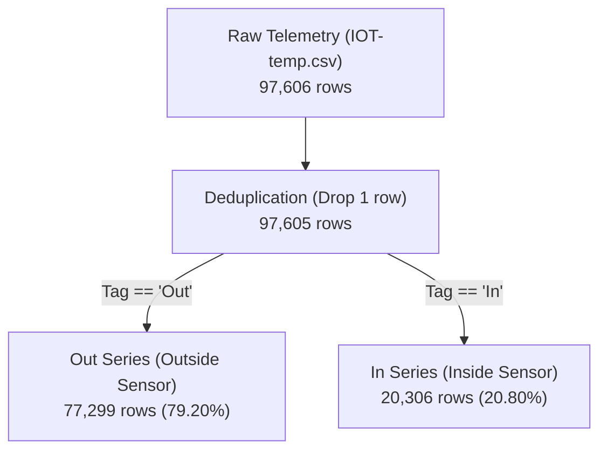

# Dataset Overview

The Cold Chain Early Warning System Digital Twin is developed and benchmarked using a real-world IoT sensor telemetry log from Kaggle: **`atulanandjha/temperature-readings-iot-devices`** (raw file: `data/raw/IOT-temp.csv`).

---

## 1. Structural Proxy Foundation

> [!WARNING]
> **STRUCTURAL PROXY NOTICE (D31):**
> This dataset originates from an IoT sensor deployment monitoring ambient temperature in an office room setting. It is **NOT** operational refrigerated transport (reefer) telemetry. All injected anomalies are synthetic mathematical constructs, and baseline thresholds carry **no food-safety, regulatory, or pharmacopeial authority**.
> 
> The dataset is utilized strictly as an **empirical structural proxy** exhibiting:
> 1. Real-world irregular sensor reporting and dropped packet behaviors.
> 2. Dual-channel ambient vs. internal dynamics (`Out` vs. `In`).
> 3. Natural diurnal thermal drift and seasonal shifts across a multi-month timeline.

---

## 2. Dataset Provenance & Characteristics

- **Source Platform:** Kaggle (`atulanandjha/temperature-readings-iot-devices`).
- **Collection Period:** 2018-07-28 00:00:00 to 2018-12-08 09:30:00 (~4.3 months / 133 days).
- **Physical Environment:** Single IoT device monitoring ambient room air temperature (`In`) and outside ambient air temperature (`Out`).
- **File Format:** Comma-Separated Values (`IOT-temp.csv`), UTF-8 encoded.

### 2.1. Raw Field Inventory
| Column Header | Data Type | Description | Observed Invariant |
| :--- | :--- | :--- | :--- |
| `id` | String | Unique telemetry log transaction identifier | `__export_...` alphanumeric string |
| `room_id/id` | String | Sensor installation location identifier | Single constant invariant: `Room Admin` (100% invariant) |
| `noted_date` | String | Telemetry capture timestamp | Format: `DD-MM-YYYY HH:MM` (Day-first string) |
| `temp` | Integer / Float | Recorded temperature in degrees Celsius (°C) | Integer values (21°C to 51°C) |
| `out/in` | String | Sensor channel categorical tag | Binary categorical: `'Out'` (outside) or `'In'` (inside) |

---

## 3. Telemetry Partitioning & Distribution

The dataset comprises **97,606 raw observations**. During preprocessing, exactly **1 exact duplicate row** is identified and eliminated, yielding **97,605 unique physical observations**.

### 3.1. Statistical Profile by Series (Clean Pre-Injection)

| Metric | Out Series (External Ambient) | In Series (Internal Ambient) | Combined / Dataset Total |
| :--- | :--- | :--- | :--- |
| **Row Count** | 77,299 rows | 20,306 rows | 97,605 rows |
| **Row Share** | 79.20% | 20.80% | 100.0% |
| **Min Temperature** | 24.00 °C | 21.00 °C | 21.00 °C |
| **Mean Temperature** | 35.85 °C | 27.24 °C | 34.05 °C |
| **Median Temperature** | 35.00 °C | 28.00 °C | 34.00 °C |
| **Max Temperature** | 51.00 °C | 41.00 °C | 51.00 °C |
| **Standard Deviation ($\sigma$)** | 5.91 °C | 1.91 °C | 6.07 °C |
| **$2\sigma$ Baseline Threshold** | **47.67 °C** | **31.06 °C** | N/A (Per-series D4) |
| **Chronological Train Split** | 63,927 rows (82.7%) | 16,539 rows (81.4%) | 80,466 rows |
| **Chronological Test Split** | 13,372 rows (17.3%) | 3,767 rows (18.6%) | 17,139 rows |

---

## 4. Sampling Irregularity & Temporal Dynamics

Unlike idealized synthetic testbeds with fixed 1-minute grids, real IoT telemetry exhibits non-uniform temporal arrival:
- **Asymmetric Reporting:** The external `Out` sensor reports roughly 3.8× more frequently than the internal `In` sensor.
- **Inter-Arrival Gaps (`gap_seconds`):**
  - **Out Series:** Median arrival gap is ~60 seconds, with minimum reporting down to sub-minute bursts and long tail dropouts up to several hours.
  - **In Series:** Median arrival gap is ~120–180 seconds, reflecting less frequent polling or higher power-saving thresholding.
- **Architectural Response (D1):** No temporal resampling or synthetic interpolation is performed. Interpolating irregular IoT logs creates phantom variance and introduces predictive data leakage. All downstream models operate over real, observed readings.

