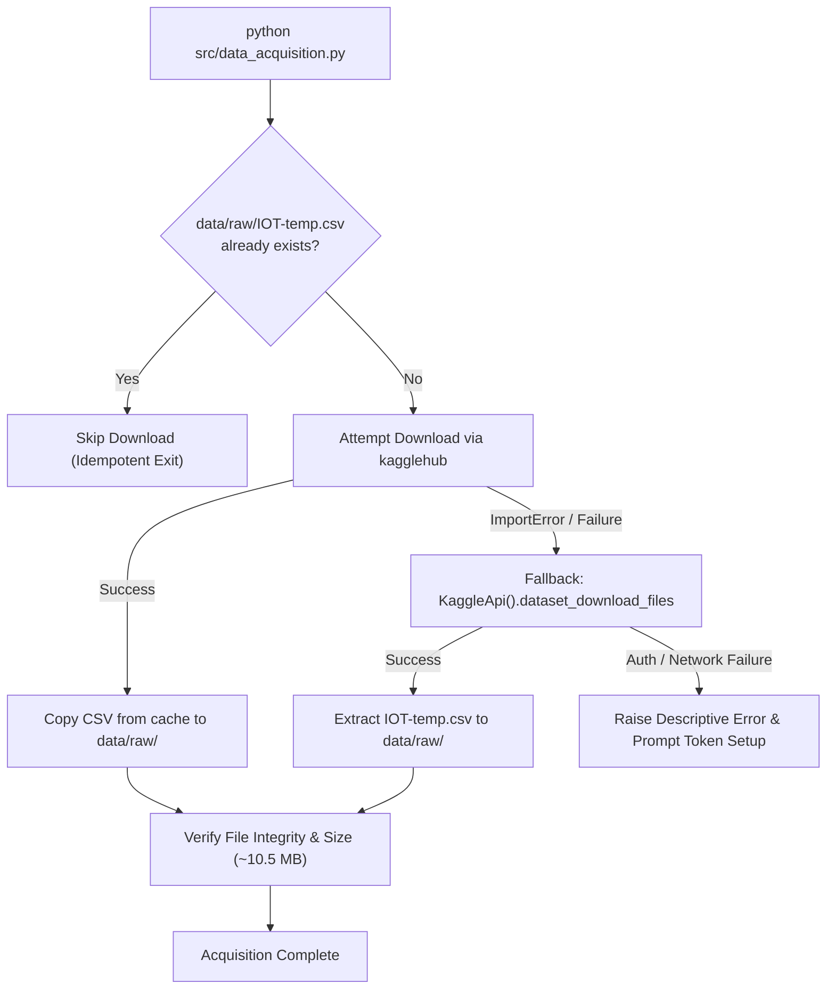

# Data Acquisition

The data acquisition subsystem (`src/data_acquisition.py`) automates the reproducible retrieval of the raw IoT temperature telemetry dataset directly from Kaggle into the local workspace.

---

## 1. Pipeline Responsibility & Objectives

- **Target Dataset:** `atulanandjha/temperature-readings-iot-devices` (Kaggle).
- **Target Destination:** `data/raw/IOT-temp.csv`.
- **Zero-Modification Policy:** The raw file is saved bit-for-bit into `data/raw/` without renaming columns, dropping rows, or applying early filtering.
- **Fail-Safe Acquisition:** Implements dual download strategies: modern `kagglehub` library with an automated fallback to standard `KaggleApi`.

---

## 2. Authentication & Security Guardrails

Under no circumstances are Kaggle API tokens, usernames, or secrets embedded in source code or committed to version control.

### 2.1. Credential Configuration
The pipeline relies on the official Kaggle authentication token (`kaggle.json`) stored in the user's home directory:
- **Windows:** `C:\Users\<username>\.kaggle\kaggle.json`
- **Linux / macOS:** `~/.kaggle/kaggle.json`

Setup procedure:
1. Navigate to [Kaggle Account Settings](https://www.kaggle.com/settings).
2. Under the **API** section, click **"Create New Token"**.
3. Place the downloaded `kaggle.json` in the appropriate directory above.
4. On Unix systems, restrict permissions:
   ```bash
   chmod 600 ~/.kaggle/kaggle.json
   ```

### 2.2. Version Control Invariants (`.gitignore`)
The repository `.gitignore` explicitly enforces security and artifact boundaries:
- `kaggle.json` and `*.json` containing API credentials are strictly ignored.
- `data/raw/` is excluded from git commits to avoid bloat and adhere to data redistribution best practices.

---

## 3. Execution Workflow & Fallback Hierarchy



---

## 4. Execution Command

To execute data acquisition:

```bash
python src/data_acquisition.py
```

Expected log output:
```text
2026-11-02 20:00:00 [INFO] Raw data directory: .../data/raw
2026-11-02 20:00:00 [INFO] Attempting download via kagglehub …
2026-11-02 20:00:05 [INFO] Copied → .../data/raw/IOT-temp.csv
2026-11-02 20:00:05 [INFO] Verification: IOT-temp.csv found (10,542,083 bytes).
```

