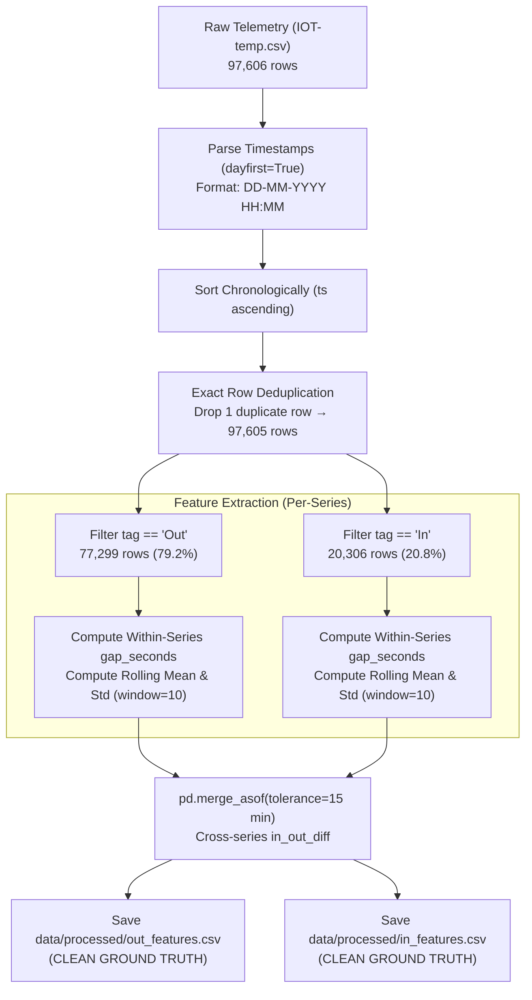

# Data Preprocessing

The preprocessing subsystem (`src/preprocessing.py`) converts raw, irregular IoT sensor logs into clean, structured, and chronologically ordered time-series feature tables (Milestone 2).

---

## 1. Architectural Guardrails & Constraints

Preprocessing is governed by strict methodological principles established in early design reviews:

1. **No Resampling or Grid Interpolation (D1):** Real cold-chain IoT telemetry is inherently irregular. Resampling onto a fixed 1-minute grid with synthetic interpolation (e.g., forward-fill or splines) invents artificial observations, creates phantom autocorrelation, and masks true sensor blackout periods. All downstream calculations operate on **real, observed sensor readings only**.
2. **Independent Series Partitioning (D2):** The physical mechanisms generating `Out` readings (external ambient air) and `In` readings (internal conditioned room) are distinct. Sensor channels are partitioned into independent dataframes.
3. **Immutability of Clean Reference Files (D3, D4):** The output feature files (`out_features.csv` and `in_features.csv`) represent **clean, uncorrupted ground truth**. They are locked post-generation and must **never** be overwritten by anomaly injection code.

---

## 2. Preprocessing Pipeline Breakdown



---

## 3. Step-by-Step Processing Details

### 3.1. Timestamp Parsing & The `dayfirst=True` Invariant
The raw timestamp column `noted_date` is formatted as `DD-MM-YYYY HH:MM` (e.g., `08-12-2018 09:30` indicates December 8, 2018, not August 12).
- **The Pitfall:** Standard pandas `pd.to_datetime()` defaults to month-first parsing (`MM-DD-YYYY`). Whenever the day integer exceeds 12, month-first parsing fails, silently producing **47,662 `NaT` (Not-a-Time) missing values** (~48.8% of the dataset).
- **The Solution:** Timestamp parsing explicitly mandates `dayfirst=True`:
  ```python
  df["ts"] = pd.to_datetime(df["noted_date"], dayfirst=True, errors="coerce")
  ```
  Result: **0 parse failures across all 97,606 records**.

### 3.2. Deduplication
Inspection in Milestone 1 EDA revealed exactly one duplicate record where all fields (`id`, `room_id/id`, `noted_date`, `temp`, `out/in`) were identical.
- Initial row count: 97,606
- Deduplicated row count: **97,605** (exactly 1 row dropped).

### 3.3. Independent Series Splitting (D2)
The dataset is split by categorical tag:
- **`df_out`:** 77,299 records (external ambient sensor).
- **`df_in`:** 20,306 records (internal ambient sensor).

---

## 4. Pipeline Execution & Verification

Run preprocessing via the command:

```bash
python src/preprocessing.py
```

### Expected Output Logs:
```text
2026-11-02 20:10:00 [INFO] Loading: .../data/raw/IOT-temp.csv
2026-11-02 20:10:01 [INFO] Dedup: 97606 → 97605 rows (dropped 1 exact duplicate(s))
2026-11-02 20:10:01 [INFO] Split → df_out: 77299 rows | df_in: 20306 rows
2026-11-02 20:10:02 [INFO] Series 'Out': 77299 rows | gap_seconds [min=0 s, median=60 s, mean=148.6 s, max=83160 s]
2026-11-02 20:10:02 [INFO] Series 'In': 20306 rows | gap_seconds [min=0 s, median=120 s, mean=566.2 s, max=83400 s]
2026-11-02 20:10:03 [INFO] in_out_diff 'Out'→'In': valid=73204 (94.70%) NaN (gap >15 min)=4095 (5.30%)
2026-11-02 20:10:03 [INFO] in_out_diff 'In'→'Out': valid=19864 (97.82%) NaN (gap >15 min)=442 (2.18%)
2026-11-02 20:10:04 [INFO] Saved (CLEAN): out_features.csv (77299 rows)
2026-11-02 20:10:04 [INFO] Saved (CLEAN): in_features.csv (20306 rows)
```

