# Pipeline Execution Guide

This guide details the commands and parameters for executing the Cold Chain EWS pipeline stages, training models, running simulation audits, and launching the interactive dashboard.

---

## 1. Complete End-to-End Pipeline Execution

All commands should be executed from the **repository root directory** within the activated virtual environment.

```mermaid
flowchart LR
    Acq["src/data_acquisition.py"] --> Prep["src/preprocessing.py"]
    Prep --> Inj["src/anomaly_injection.py"]
    Inj --> Base["src/baseline_and_labels.py"]
    Base --> IF["src/isolation_forest_model.py<br>src/if_evaluation.py"]
    IF --> LSTM["src/lstm_prep.py<br>src/lstm_evaluation.py"]
    LSTM --> Comp["src/three_way_comparison.py"]
    Comp --> Twin["src/twin_monitors.py<br>src/twin_crosscheck.py"]
    Twin --> Dash["streamlit run dashboard/app.py"]
```



---

## 2. Milestone-by-Milestone CLI Commands

### Milestone 1: Data Acquisition
Downloads `IOT-temp.csv` directly into `data/raw/`:
```bash
python src/data_acquisition.py
```

### Milestone 2: Preprocessing, Feature Engineering & Anomaly Injection
1. Clean, deduplicate, and engineer within-series and cross-series features:
   ```bash
   python src/preprocessing.py
   ```
2. Inject synthetic step, drift, and flatline anomalies onto data copies:
   ```bash
   python src/anomaly_injection.py
   ```
3. Compute clean baseline thresholds and evaluate proxy irreversibility:
   ```bash
   python src/baseline_and_labels.py
   ```

### Milestone 3: Isolation Forest Model
1. Train Isolation Forest models on train split ($t < \text{cutoff}$):
   ```bash
   python src/isolation_forest_model.py
   ```
2. Evaluate point-wise confusion metrics and operational lead times:
   ```bash
   python src/if_evaluation.py
   ```

### Milestone 4: LSTM-Autoencoder Evaluation
1. Prepare sliding window arrays and compute train-only normalization statistics:
   ```bash
   python src/lstm_prep.py
   ```
2. Execute causal last-step MSE inference using pre-trained weights (`models/lstm_*.h5`):
   ```bash
   python src/lstm_evaluation.py
   ```

### Milestone 5: Digital Twin Simulation & Milestone 5b Parity Audit
1. Execute the 3-stage SimPy digital twin skeleton replay:
   ```bash
   python src/digital_twin.py
   ```
2. Run stateful streaming monitors (`BaselineMonitor`, `IFMonitor`, `LSTMMonitor`) over the full replay stream:
   ```bash
   python src/twin_monitors.py
   ```
3. Execute the Milestone 5b Cross-Check Parity Audit comparing batch vs. live alarm timestamps:
   ```bash
   python src/twin_crosscheck.py
   ```

### Milestone 6: Master Comparison & Presentation Dashboard
1. Compile the master three-way comparison scorecard (`three_way_comparison.csv`):
   ```bash
   python src/three_way_comparison.py
   ```
2. Launch the Streamlit presentation dashboard:
   ```bash
   streamlit run dashboard/app.py
   ```

---

## 3. Launching the Interactive Dashboard

To start the local dashboard web application:

```bash
streamlit run dashboard/app.py
```

### 3.1. Advanced Startup Options
- **Specify Custom Port:**
  ```bash
  streamlit run dashboard/app.py --server.port 8502
  ```
- **Headless Mode (Remote Server / Cloud VM):**
  ```bash
  streamlit run dashboard/app.py --server.headless true
  ```
- **Accessing the UI:**
  Open your web browser and navigate to:
  `http://localhost:8501`

---

## 4. Automated Regression Testing

To run the unit test suite and verify buffer pre-warming parity:

```bash
python -m unittest tests/test_d33_prewarm.py
```
*(Or run all discovered tests: `python -m unittest discover tests`)*

