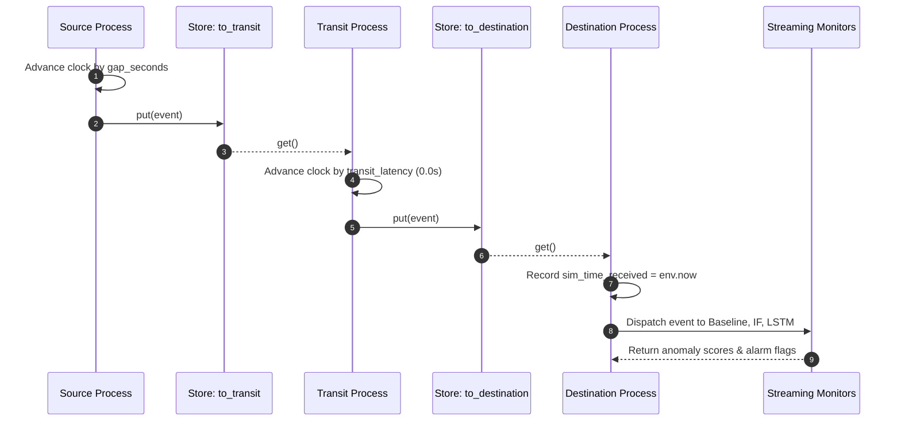

# Event Processing Pipeline

This document details the telemetry packet data structure, asynchronous queue communication, and event lifecycle across the digital twin simulation stages.

---

## 1. Telemetry Event Packet Schema

Each telemetry observation emitted by the Source process is encapsulated as a strongly-typed dictionary event packet:

```python
event = {
    "series": series_name,                   # String: 'Out' or 'In'
    "ts": row["ts"],                         # pd.Timestamp: Telemetry capture timestamp
    "temp_injected": float(row["temp_injected"]), # Float: Temperature with injected perturbations (°C)
    "gap_seconds": float(row["gap_seconds"]),     # Float: Seconds since previous observation in series
    "is_injected_anomaly": bool(row["is_injected_anomaly"]), # Boolean: Ground-truth label
    "injection_type": str(row["injection_type"]),            # String: 'step', 'drift', 'flatline', or 'None'
}
```

---

## 2. Asynchronous Queue Architecture (SimPy Stores)

Stages communicate via unbounded **SimPy Stores** (`simpy.Store`), implementing asynchronous producer-consumer message queues:



---

## 3. Detailed Event Lifecycle

### 3.1. Stage 1: Emission (`source_process`)
1. Telemetry DataFrame is sorted chronologically by `ts` ascending, and stable-sorted by `gap_seconds` descending to maintain deterministic intra-minute order.
2. Extracts `gap_seconds`. If NaN (first row), defaults to `0.0`.
3. Yields `env.timeout(gap)`. SimPy's virtual clock advances to the exact second of packet emission.
4. Generates the event packet dictionary.
5. Emits the packet into `to_transit.put(event)`.

### 3.2. Stage 2: Network Transit (`transit_process`)
1. Blocks until a packet arrives in `to_transit`: `event = yield to_transit.get()`.
2. Simulates network transmission delay: `yield env.timeout(transit_latency)`.
3. With `TRANSIT_LATENCY_SECONDS = 0.0`, control yields immediately without advancing the virtual clock.
4. Forwards the packet to the destination queue: `yield to_destination.put(event)`.

### 3.3. Stage 3: Ingestion & Evaluation (`destination_process`)
1. Blocks until a packet arrives in `to_destination`: `event = yield to_destination.get()`.
2. Stamps the arrival with the current simulation timestamp:
   ```python
   sim_time_received = env.now
   ```
3. Dispatches the packet to the active detector monitors:
   - `baseline_monitor.process_event(event)`
   - `if_monitor.process_event(event)`
   - `lstm_monitor.process_event(event)`
4. Persists the alarm record and evaluation diagnostics for audit logging and UI display.

