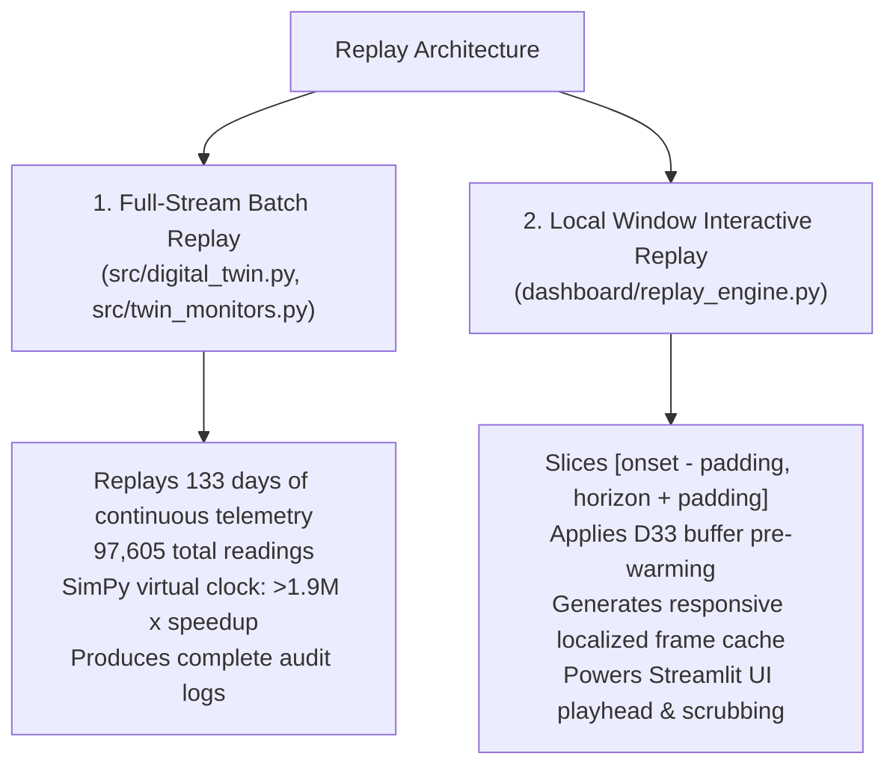

# Telemetry Replay Mechanism

This document describes the replay architecture utilized by the digital twin to simulate historical telemetry streams for batch verification and interactive dashboard visualization.

---

## 1. Replay Operating Modes

The digital twin supports two distinct execution patterns:



---

## 2. Local Window Slicing & Pre-Warming (`replay_engine.py`)

For interactive UI demonstration, executing all 97,605 readings on every user click would introduce unnecessary latency. The engine extracts an isolated simulation window:

1. **Temporal Boundaries:**
   - Onset timestamp: $t_{\text{onset}}$
   - Horizon end timestamp: $t_{\text{horizon\_end}} = t_{\text{end}} + 60.0\text{ minutes}$
   - Window Start: $t_{\text{win\_start}} = t_{\text{onset}} - \Delta t_{\text{pad}}$ (default: $2.0\text{ hours}$)
   - Window End: $t_{\text{win\_end}} = t_{\text{horizon\_end}} + \Delta t_{\text{pad}}$
2. **D33 Pre-Warming Execution:**
   To ensure that the first frame of the sliced window does not suffer from cold-start calculation errors:
   - Queries the historical stream for up to 30 readings immediately preceding $t_{\text{win\_start}}$.
   - Feeds these observations through `IFMonitor` and `LSTMMonitor` with alarm emission disabled.
   - Initialized deques are primed with valid thermal history.
3. **Simulation Output:** Produces an in-memory `sim_df` containing raw readings, rolling features, anomaly scores, and alarm flags.

---

## 3. Display-Only Playback Acceleration (D28)

The dashboard allows users to adjust the replay playback speed across multiple settings: `1x`, `5x`, `10x`, `25x`, and `Instant`.

> [!IMPORTANT]
> **Mathematical Invariance Rule (D28):**
> Playback acceleration is strictly a **display-only visualization control**. It alters solely the client-side thread pause (`time.sleep`) between Streamlit reactive reruns:
> - `1x`: 0.40 seconds per frame
> - `5x`: 0.12 seconds per frame
> - `10x`: 0.06 seconds per frame
> - `25x`: 0.02 seconds per frame
> - `Instant`: 0.005 seconds per frame
> 
> Under no circumstances does playback acceleration modify sensor readings, condense timestamps, or compress inter-arrival gaps fed to detector models.

---

## 4. Playhead State Synchronization & Scrubbing

- **Session State Persistence:** The active playhead position is stored in `st.session_state[f"playhead_{injection_id}"]`.
- **Scrubbing Slider:** Moving the timeline slider instantly updates the active frame index.
- **Active Telemetry Slicing:**
  ```python
  active_slice = sim_df.iloc[: current_frame + 1]
  current_reading = sim_df.iloc[current_frame]
  ```
- **Reactive UI Synchronization:**
  - KPI cards update with instantaneous values at `current_reading['ts']`.
  - Alert log dynamically displays only alerts generated up to `current_frame`.
  - Altair chart draws a dashed blue playhead rule aligned with the current timestamp.

