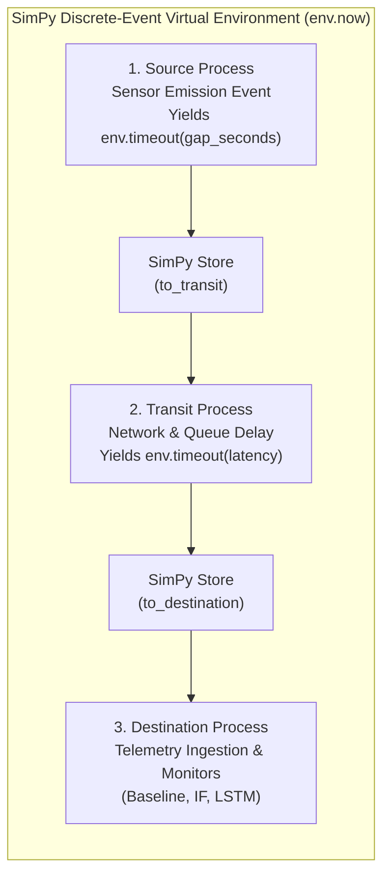

# SimPy Discrete-Event Simulation Engine

The Digital Twin Simulation Engine (`src/digital_twin.py`) leverages the **SimPy** discrete-event framework to simulate the streaming transmission, network transit, and algorithmic evaluation of cold-chain telemetry packets.

---

## 1. Motivation: Why Discrete-Event Simulation?

Evaluating an early warning system against months of cold-chain operations poses a fundamental temporal challenge:
- Real-world pharmaceutical and perishable transit spans weeks or months (the proxy dataset spans **133 days / 4.3 months**).
- Waiting for physical wall-clock pacing is infeasible for automated CI/CD testing, scientific regression benchmarking, and interactive UI exploration.
- Wall-clock sleep delays introduce non-deterministic operating system thread scheduling jitter, corrupting precise timestamp benchmarking.

**SimPy discrete-event simulation** solves this by decoupling the **virtual simulation clock** from wall-clock time:
- The simulation clock jumps instantaneously from event to event based on exact inter-arrival deltas ($\Delta t = \text{gap\_seconds}$).
- Replaying all **97,605 telemetry observations** executes in **$< 6.0\text{ seconds}$** on standard hardware, representing a simulation acceleration factor exceeding **$1,900,000\times$ faster than real time**.

---

## 2. Three-Stage Data Pipeline Topology (D17)

> [!IMPORTANT]
> **Data-Pipeline Abstraction Notice (D17):**
> The three stages—**Source**, **Transit**, and **Destination**—model a software and telemetry data pipeline. They do **not** represent a physical multi-location logistics route (e.g., farm $\to$ reefer truck $\to$ distribution center). Milestone 1 EDA verified that the underlying IoT dataset carries a 100% constant location invariant (`room_id = 'Room Admin'`).



---

## 3. Virtual Clock Mechanics (D18)

In accordance with Design Decision **D18**:
- The virtual clock (`env.now`, denominated in seconds) advances strictly by the real, observed inter-arrival gaps computed in Milestone 2 (`gap_seconds`).
- The engine does **not** employ fixed 1-second ticks or resampled 60-second time slots.
- For each telemetry record, the Source process executes:
  ```python
  gap = float(row["gap_seconds"]) if pd.notna(row["gap_seconds"]) else 0.0
  yield env.timeout(gap)
  ```
- **As-Observed Stream (D18):** Replay uses `temp_injected`—the exact sensor values that an operational monitoring system would observe in production—never the unperturbed `temp` column.

---

## 4. Transit Latency & Zero-Delay Invariant (D19)

The Transit process models communication latency between edge sensors and central monitoring servers:
```python
def transit_process(env, to_transit, to_destination, transit_latency):
    while True:
        event = yield to_transit.get()
        yield env.timeout(transit_latency)
        yield to_destination.put(event)
```

- **`TRANSIT_LATENCY_SECONDS = 0.0` (Default Invariant):**
  To maintain 100% mathematical parity against frozen offline batch evaluations in Milestone 5b, transmission latency is disabled by default.
- Under this setting, the arrival time at the Destination (`sim_time_received`) equals the exact cumulative sum of inter-arrival gaps:
  
  $$\text{sim\_time\_received}_i = \sum_{k=1}^i \text{gap\_seconds}_k$$

---

## 5. Execution Performance & Benchmarks

Simulating the complete 97,605-row telemetry stream across both `Out` and `In` channels produces the following benchmarks:

| Execution Metric | Benchmark Observation |
| :--- | :--- |
| **Simulated Physical Time** | 133 days, 9 hours, 30 minutes ($11,525,400\text{ virtual seconds}$) |
| **Simulated Event Count** | 97,605 telemetry packets (77,299 Out + 20,306 In) |
| **Local CPU Execution Time** | $\approx 5.85\text{ seconds}$ |
| **Virtual-to-Wall-Clock Ratio** | **$> 1.96 \times 10^6 \times$ Acceleration** |
| **Deterministic Consistency** | 100% identical event order across repeated runs |

