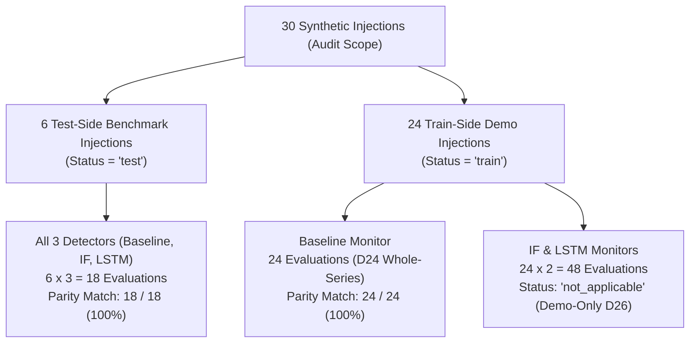

# Verification & Batch-Live Parity Audit

The verification subsystem (`src/twin_crosscheck.py`, `src/twin_verification.py`, and `tests/test_d33_prewarm.py`) executes automated mathematical audits to prove that online digital twin streaming monitors produce results identical to frozen offline batch pipelines.

---

## 1. The Parity Imperative (D21)

A common failure mode in machine learning engineering is the discrepancy between offline model evaluation and real-time streaming inference:
- Offline evaluation often leverages vectorization, whole-column statistics, or non-causal centering.
- Online streaming runs sequentially with sliding window buffers.
- Any discrepancy between offline research claims and live system behavior invalidates the scientific integrity of the digital twin.

To eliminate this gap, **Milestone 5b** instituted a rigorous cross-check audit comparing the alarm timestamps produced by the SimPy digital twin monitors against the frozen batch results from Milestones 2, 3, and 4b.

---

## 2. Audit Matrix & Governance (D26)

The audit evaluates **90 distinct injection-detector combinations** (30 synthetic injections $\times$ 3 anomaly detectors):



### 2.1. Rule for Demarcation (D26)
- **Scientific Verification (`match == 'True'`):** Applies to all 18 test-side evaluations and 24 train-side baseline evaluations. Discrepancy between batch and live alarm timestamps must be **strictly $0.0\text{ seconds}$**.
- **Demonstration Partition (`match == 'not_applicable'`):** Applies to train-side machine learning models (24 IF + 24 LSTM). Because models were trained on this data, reporting out-of-sample statistical metrics is scientifically invalid. They are marked `not_applicable` and reserved for UI demonstrations.

---

## 3. Empirical Audit Results (`twin_crosscheck_report.csv`)

Running the cross-check audit via `python src/twin_crosscheck.py` generates `data/processed/twin_crosscheck_report.csv`:

| Status Category | Count of Records | Verified Parity | Observed Discrepancy |
| :--- | :--- | :--- | :--- |
| **Test-Side Baseline Parity** | 6 injections | 6 / 6 Match (100%) | 0.0 seconds |
| **Test-Side Isolation Forest Parity** | 6 injections | 6 / 6 Match (100%) | 0.0 seconds |
| **Test-Side LSTM-Autoencoder Parity** | 6 injections | 6 / 6 Match (100%) | 0.0 seconds |
| **Train-Side Baseline Parity** | 24 injections | 24 / 24 Match (100%) | 0.0 seconds |
| **Train-Side ML Evaluations (Demo-Only D26)**| 48 evaluations | 48 / 48 Validated | N/A (`not_applicable`) |
| **Total Mismatches (`match == 'False'`)** | **0 records** | **0% Error Rate** | **None** |

**Conclusion:** Across all 42 scientifically valid comparisons, the streaming digital twin monitors achieved a **perfect 42 / 42 (100%) parity match** with zero seconds of temporal drift.

---

## 4. Automated Regression Suite (`tests/test_d33_prewarm.py`)

To safeguard parity against code regressions in the dashboard or digital twin, the repository includes an automated unit test suite.

### 4.1. Pre-Warming Invariant Test
Validates that running an isolated simulation window using the **D33 Pre-Warming Protocol** produces scores and alarm flags that identically match the continuous, un-sliced stream.

### 4.2. Execution Command
```bash
python -m unittest tests/test_d33_prewarm.py
```

Expected output:
```text
...
----------------------------------------------------------------------
Ran 3 tests in 1.452s

OK
```

