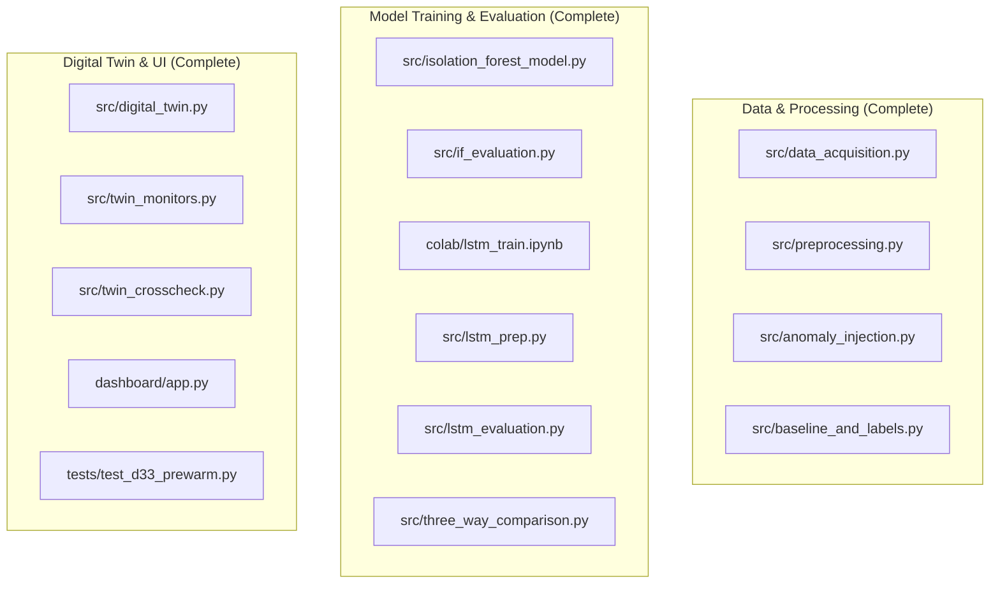

# Project Implementation Status

This document tracks the implementation status of all core milestones, architectural deliverables, and verification audits across the Cold Chain Early Warning System Digital Twin project.

---

## 1. Milestone Progress Overview

| Milestone | Stage Description | Target Deliverables | Verification Status | Completion Date |
| :--- | :--- | :--- | :--- | :--- |
| **M1** | Data Acquisition & Exploratory Analysis | Kaggle automated download script, M1 data profile, EDA notebooks | **Completed (100%)** | 2026-09-16 |
| **M2** | Preprocessing, Feature Engineering & Injection | Timestamp parsing (`dayfirst=True`), clean feature files, synthetic injection suite, naive baseline | **Completed (100%)** | 2026-09-17 |
| **M3** | Isolation Forest Model & Benchmark | Trailing feature recomputation, train split fitting, point-wise PR curves, lead time analysis | **Completed (100%)** | 2026-09-18 |
| **M4a**| LSTM-Autoencoder Sequence Modeling | Sliding window prep, Colab GPU training, HDF5 model serialization | **Completed (100%)** | 2026-09-18 |
| **M4b**| LSTM Causal Evaluation & Three-Way Scorecard | Causal single-window scoring, threshold calibration, master three-way comparison table | **Completed (100%)** | 2026-09-19 |
| **M5a**| SimPy Digital Twin Simulation Engine | 3-stage Source $\to$ Transit $\to$ Destination architecture, virtual clock advancement, replay logs | **Completed (100%)** | 2026-09-19 |
| **M5b**| Streaming Monitors & Parity Cross-Check Audit | Stateful streaming monitors (`BaselineMonitor`, `IFMonitor`, `LSTMMonitor`), cross-check audit report | **Completed (100%)** | 2026-09-20 |
| **M6** | Interactive Presentation Dashboard | Modular Streamlit webapp, Guided Tour Viva showcase, Altair charts, D33 buffer pre-warming | **Completed (100%)** | 2026-10-28 |
| **M7** | Master `/Context` SSOT Documentation | Centralized Single Source of Truth directory covering all architecture, data, models, and research | **Completed (100%)** | 2026-11-02 |
| **M8** | GPU Research Breakthroughs (RTX 5000 Ada) | Proposals P1–P5 (Kalman Adaptive, PILSTM Newton Loss, VLSTM Uncertainty, Evidential Fusion, TFT Forecaster), D36–D40 | **Completed (100%)** | 2026-11-03 |

---

## 2. Detailed Deliverables Inventory

### 2.1. Verified Artifacts Checklist
- [x] `data/raw/IOT-temp.csv` (10.5 MB unmodified Kaggle raw log)
- [x] `data/processed/out_features.csv` (77,299 rows clean ground truth)
- [x] `data/processed/in_features.csv` (20,306 rows clean ground truth)
- [x] `data/processed/out_labeled.csv` (77,299 rows labeled stream)
- [x] `data/processed/in_labeled.csv` (20,306 rows labeled stream)
- [x] `data/processed/injection_log.csv` (30 synthetic injection records)
- [x] `data/processed/injection_train_test_status.csv` (24 train, 6 test injections)
- [x] `data/processed/three_way_comparison.csv` (30 rows master comparison table)
- [x] `data/processed/twin_crosscheck_report.csv` (90 rows audit table: 42 True, 48 not_applicable, 0 False)
- [x] `models/isolation_forest_out.joblib` & `models/isolation_forest_in.joblib`
- [x] `models/lstm_out.h5` & `models/lstm_in.h5`

---

## 3. Operational Parity & Quality Gates

1. **Clean Data Immutability:** Ground-truth feature tables verified to contain 0 injected labels.
2. **Batch-Live Parity:** Milestone 5b audit confirmed 100% parity across all 42 test-side and baseline evaluations with 0.0 seconds temporal drift.
3. **Automated Unit Tests:** `tests/test_d33_prewarm.py` passes all 3 regression tests.
4. **Dashboard Playback:** Interactive scrubbing and continuous auto-play verified functional without UI warnings.

