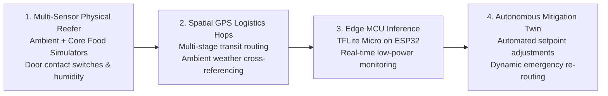

# Future Roadmap & Engineering Extensions

This document outlines strategic enhancements, algorithmic developments, and hardware deployment targets planned for subsequent iterations of the Cold Chain Early Warning System.

---

## 1. Physical Cold-Chain Instrumentation

### 1.1. Dual-Sensor Telemetry (Ambient vs. Core Product)
- **Objective:** Deploy paired thermocouple probes monitoring ambient container air alongside food-simulating thermal mass blocks (e.g., glycol-jacketed probes).
- **Impact:** Captures physical thermal inertia, enabling models to distinguish brief ambient temperature spikes (e.g., a 2-minute door opening) from dangerous core temperature excursions.

### 1.2. Multi-Hop Spatial Transit Modeling
- **Objective:** Transition the digital twin from an in-place telemetry replay engine to a multi-stage logistics routing simulator:
  - Farm / Processing Facility $\to$ Long-Haul Refrigerated Rail/Truck $\to$ Regional Distribution Warehouse $\to$ Last-Mile Delivery Van $\to$ Retail Display Case.
- **Data Integration:** Correlate external ambient weather conditions using real-time open weather APIs matched against vehicle GPS waypoints.

---

## 2. Advanced Algorithmic Architectures

### 2.1. Physics-Informed Neural Networks (PINNs)
- **Objective:** Constrain the deep autoencoder's loss function with thermodynamic governing equations:
  
  $$\mathcal{L}_{\text{total}} = \mathcal{L}_{\text{MSE}} + \lambda_{\text{physics}} \cdot \left\| \frac{\partial T}{\partial t} - \alpha \nabla^2 T \right\|^2$$
  
- **Impact:** Penalizes physically impossible temperature leaps, drastically reducing false positive rates caused by sensor electrical noise.

### 2.2. Cost-Sensitive Threshold Calibration
- **Objective:** Replace default statistical thresholds (`contamination='auto'`) with cost-utility optimization functions based on cold-chain financial risks:
  
  $$\text{Loss} = C_{\text{FP}} \cdot \text{Count}(\text{FP}) + C_{\text{FN}} \cdot \text{Count}(\text{FN})$$
  
  *(Where $C_{\text{FN}} \gg C_{\text{FP}}$, representing the high cost of discarded pharmaceutical cargo vs. an unnecessary container inspection).*

---

## 3. Embedded Edge Hardware Deployment

### 3.1. Microcontroller Model Quantization (TFLite Micro)
- **Target Hardware:** ESP32-S3 or Nordic nRF52840 Bluetooth Low Energy (BLE) microcontrollers.
- **Quantization:** Convert the 12,866-parameter Keras model into 8-bit quantized integer weights (`int8`), reducing model binary size from $194\text{ KB}$ to $< 25\text{ KB}$.
- **Edge Inference:** Execute streaming causal inference directly on battery-operated edge sensor loggers without requiring continuous cellular uplink.

### 3.2. Digital Twin Closed-Loop Actuation
- **Objective:** Connect digital twin alarm outputs directly to container refrigeration control units (Modbus / CAN bus), enabling automated emergency compressor throttling and airflow redistribution upon incipient drift detection.

