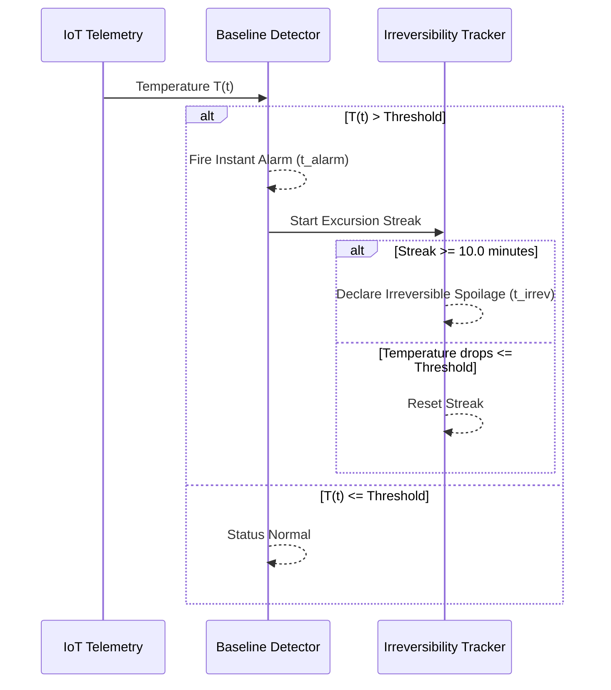

# Naive Baseline Detector

The Naive Baseline Detector (`src/baseline_and_labels.py`) represents the standard industrial temperature monitoring paradigm: a static, scalar threshold based on conventional statistical limits.

---

## 1. Problem Formulation & Theoretical Role

In cold-chain logistics and warehouse management, legacy SCADA systems and USB temperature loggers rely on static excursion tripwires. When temperature exceeds an upper threshold, an audible alarm or SMS alert is dispatched.

Within this research project, the Naive Baseline Detector serves as the **comparative baseline control**:
- It demonstrates the fundamental limitation of static thresholds: alarms trigger only **after** heat penetration has already occurred.
- It provides the anchor timestamps ($t_{\text{alarm, baseline}}$ and $t_{\text{irrev}}$) against which advanced machine learning lead times are benchmarked.

---

## 2. Mathematical Definition & Threshold Calibration

### 2.1. Threshold Formulation (D4)
Thresholds are computed on a per-series basis strictly from the clean, uncorrupted feature files (`out_features.csv`, `in_features.csv`):

$$\tau_{\text{baseline}} = \mu_{\text{clean}} + K_{\sigma} \cdot \sigma_{\text{clean}}$$

Where:
- $\mu_{\text{clean}}$ is the empirical sample mean of unperturbed temperature.
- $\sigma_{\text{clean}}$ is the empirical sample standard deviation.
- $K_{\sigma} = 2.0$ (`K_SIGMA = 2.0`, standard $2\sigma$ heuristic).

### 2.2. Empirical Threshold Values

| Series Channel | Clean Sample Size ($N$) | Mean ($\mu_{\text{clean}}$) | Std Dev ($\sigma_{\text{clean}}$) | Baseline Threshold ($\tau$) |
| :--- | :--- | :--- | :--- | :--- |
| **Out Series (External)** | 77,299 | 35.8504 °C | 5.9103 °C | **47.6710 °C** |
| **In Series (Internal)** | 20,306 | 27.2434 °C | 1.9069 °C | **31.0573 °C** |

> [!CAUTION]
> **Contamination Guard:** Under no circumstances are thresholds calculated using `out_labeled.csv` or `in_labeled.csv`. Including synthetic anomalies in baseline statistics would artificially inflate $\mu$ and $\sigma$, degrading sensitivity.

---

## 3. Alarm Mechanism & Irreversibility Definition

### 3.1. Single-Reading Alarm Tripwire
An alarm is triggered at the **first individual observation** post-onset that exceeds the static threshold:

$$t_{\text{alarm, baseline}} = \min \{ t \ge t_{\text{onset}} \mid T_{\text{injected}}(t) > \tau_{\text{baseline}} \}$$

There is no sustained-duration filter for the initial alarm.

### 3.2. Proxy Irreversibility ($t_{\text{irrev}}$)
Irreversibility approximates the point of cumulative product damage. It is defined as the start of the first temporal streak where temperature remains continuously above $\tau_{\text{baseline}}$ for at least 10 minutes (`D_IRREV_MINUTES = 10.0`):

$$\Delta t_{\text{streak}} = t_{\text{streak\_end}} - t_{\text{streak\_start}} \ge 10.0\text{ minutes}$$

If qualified, $t_{\text{irrev}} = t_{\text{streak\_start}}$.

### 3.3. Lead Time Horizon
Baseline lead time represents the remaining runway from initial alarm to irreversibility:

$$\text{Lead Time}_{\text{baseline}} = t_{\text{irrev}} - t_{\text{alarm, baseline}}$$

Because $t_{\text{alarm}}$ trips at the very beginning of the streak, baseline lead time is typically **0.0 minutes** (simultaneous trip) or bounded by the temporal sampling resolution.

---

## 4. Search Horizon Bounding (D4 Fix)

To prevent post-injection natural weather variations (e.g., a hot day 3 weeks later) from being falsely attributed to an injection:
- All alarm and irreversibility searches are strictly confined to the window:
  
  $$\mathcal{W}_{\text{search}} = [t_{\text{onset}}, t_{\text{end}} + 60.0\text{ minutes}]$$
  
- If no reading crosses the threshold within $\mathcal{W}_{\text{search}}$, $t_{\text{alarm}}$ and $t_{\text{irrev}}$ evaluate to `None`.

---

## 5. Strengths & Systemic Limitations

### Strengths
- **Computational Overhead:** $\mathcal{O}(1)$ instantaneous complexity; zero memory overhead.
- **Determinism:** 100% predictable behavior with zero training requirements.
- **Catastrophic Detection:** Rapidly detects massive step spikes ($+15^\circ\text{C}$) that cross threshold boundaries.

### Limitations
- **Zero Early Warning:** Incipient thermal drifts are completely ignored while temperature remains below $47.67^\circ\text{C}$ (Out) or $31.06^\circ\text{C}$ (In).
- **Sensor Flatline Blind Spot:** A frozen sensor reporting $41.0^\circ\text{C}$ continuously will **never** trigger a baseline alarm, allowing silent equipment failures to persist indefinitely.
- **High False Alarm Vulnerability:** Extreme ambient heatwaves naturally push valid readings past $47.67^\circ\text{C}$, causing operator alarm fatigue.

