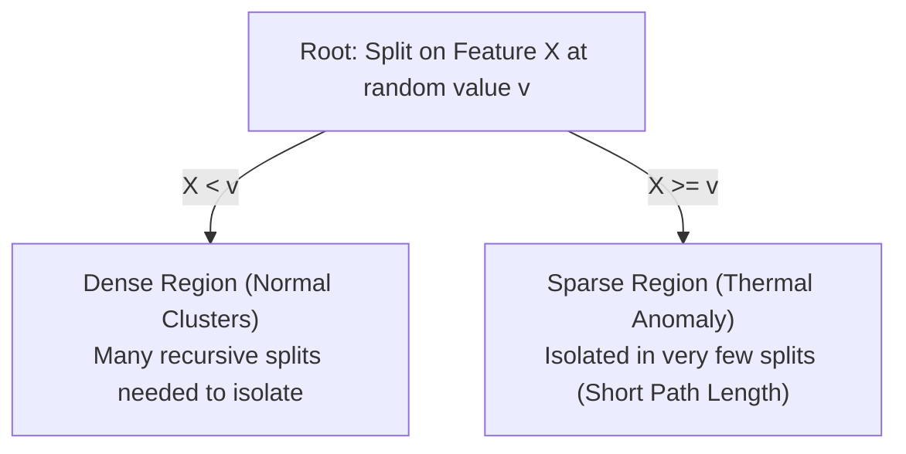

# Isolation Forest Anomaly Detector

The Isolation Forest detector (`src/isolation_forest_model.py`, `src/if_evaluation.py`) provides unsupervised tabular anomaly detection by isolating unusual observations through recursive random feature space partitioning.

---

## 1. Problem Formulation & Theoretical Intuition

Traditional distance- or density-based anomaly detectors struggle with high computational complexity ($\mathcal{O}(n^2)$) on large time series. Isolation Forest operates under the premise that anomalies are "few and different":
- Normal observations reside in dense clusters and require many random splits to isolate.
- Anomalies reside in sparse peripheral regions and are isolated near the root of random decision trees (iTrees).

### 1.1. Mathematical Formulation
Given an ensemble of $t$ isolation trees, the anomaly score $s(x, n)$ for an observation $x$ across a dataset of size $n$ is:

$$s(x, n) = 2^{-\frac{\mathbb{E}(h(x))}{c(n)}}$$

Where:
- $h(x)$ is the path length (number of edges traversed from root to external terminating leaf).
- $\mathbb{E}(h(x))$ is the expected path length across all isolation trees in the forest.
- $c(n)$ is the average path length of unsuccessful searches in a Binary Search Tree (BST):

$$c(n) = 2 \left( \ln(n - 1) + 0.5772156649 \right) - \frac{2(n - 1)}{n}$$

In scikit-learn, the continuous score is exposed via `decision_function(x)`:
- Scores $< 0$ denote anomalies.
- Scores $\ge 0$ denote nominal observations.

---

## 2. Model Architecture & Hyperparameters

| Parameter | Configuration Value | Theoretical / Architectural Rationale |
| :--- | :--- | :--- |
| **Algorithm** | `sklearn.ensemble.IsolationForest` | Robust, tree-based non-parametric partitioning. |
| **`n_estimators`** | `100` | Standard ensemble capacity balancing variance reduction and CPU inference speed. |
| **`contamination`** | `'auto'` | **Strict Non-Leakage Rule (D7):** Uses scikit-learn's default offset. Not tuned to synthetic injection ratios. |
| **`random_state`** | `42` (`IF_RANDOM_STATE`) | Ensures deterministic reproducibility of random splits. |
| **`max_samples`** | `'auto'` ($\min(256, n)$) | Subsampling hyperparameter preventing masking and swamping. |
| **Feature Vector** | 4-Dimensional | `[temp_injected, gap_seconds, rolling_mean_if, rolling_std_if]` |

### 2.1. Recomputed Feature Pipeline (D5, D22)
Isolation Forest requires trailing rolling features that reflect active perturbations:
- `temp_injected`: Instantaneous sensor reading.
- `gap_seconds`: Time since prior reading within the same channel.
- `rolling_mean_if`: Trailing 10-reading rolling average of `temp_injected`.
- `rolling_std_if`: Trailing 10-reading rolling standard deviation of `temp_injected`.

---

## 3. Training & Inference Partitioning (D6)

Training is strictly segregated from test evaluation using the chronological boundary:
$$\text{Cutoff Timestamp} = \mathbf{2018\text{-}10\text{-}29\ 11:10:48}$$

- **Out Model (`models/isolation_forest_out.joblib`):** Fitted on the first 63,927 readings of the Out series.
- **In Model (`models/isolation_forest_in.joblib`):** Fitted on the first 16,539 readings of the In series.

---

## 4. Empirical Evaluation on Test Partition (D35 Ground Truth)

Evaluated across the held-out test partitions (13,372 Out rows, 3,767 In rows):

### 4.1. Point-Wise Performance Summary

| Metric | Out Series (External Ambient) | In Series (Internal Conditioned) |
| :--- | :--- | :--- |
| **True Positives (TP)** | 52 | 21 |
| **False Positives (FP)** | 6,067 | 1,010 |
| **True Negatives (TN)** | 7,240 | 2,734 |
| **False Negatives (FN)** | 13 | 2 |
| **Point-Wise Recall** | **80.00%** | **91.30%** |
| **Point-Wise Precision** | 0.85% | 2.04% |
| **F1 Score** | 0.0168 | 0.0398 |
| **False Positive Rate (FPR)** | 45.59% | 26.98% |
| **PR-AUC (Continuous Score)** | **0.0676** | **0.2371** |

### 4.2. Analysis of the False Positive Paradox
The low point-wise precision (0.85% and 2.04%) is an expected mathematical consequence of evaluating continuous time-series models against extreme class imbalance (~0.5% injected rows) with `contamination='auto'`.
- The untuned default threshold flags borderline natural diurnal fluctuations.
- However, from an **early warning lead time perspective**, Isolation Forest excels:
  - On **`out_drift_001`**, it flags the initial trajectory shift **64.0 minutes** prior to the baseline threshold crossing.
  - On **`in_drift_016`**, it flags the drift **54.0 minutes** prior to baseline trip.

---

## 5. Artifacts & Code Implementation

- **Model Training Pipeline:** [`src/isolation_forest_model.py`](file:///d:/Lab/Managing%20Corporate%20Entrepreneurship/coldchain-ews-twin/src/isolation_forest_model.py)
- **Evaluation & PR Analysis:** [`src/if_evaluation.py`](file:///d:/Lab/Managing%20Corporate%20Entrepreneurship/coldchain-ews-twin/src/if_evaluation.py)
- **Serialized Model Weights:**
  - `models/isolation_forest_out.joblib` (1,022 KB)
  - `models/isolation_forest_in.joblib` (850 KB)
- **Evaluation Output Tables:**
  - `data/processed/if_evaluation.csv`
  - `data/processed/if_pointwise_metrics.json`
  - `data/processed/if_pr_curve_out.csv` and `in.csv`

