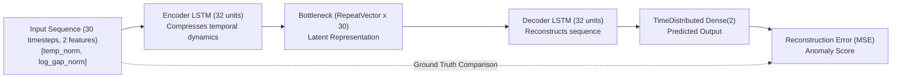

# LSTM-Autoencoder Sequence Detector

The LSTM-Autoencoder detector (`src/lstm_prep.py`, `colab/lstm_train.ipynb`, `src/lstm_evaluation.py`) is a deep recurrent neural network designed to capture temporal autocorrelation, rates of change, and multi-step sequence patterns in bivariate IoT telemetry.

---

## 1. Problem Formulation & Theoretical Intuition

While tree-based models treat consecutive observations with rolling window features, they lack explicit recurrent state memory. An autoencoder trained exclusively on nominal operational telemetry learns a low-dimensional manifold representing healthy thermal dynamics.

When presented with an anomalous thermal pattern:
- The compressed bottleneck representation fails to encode the out-of-distribution sequence.
- The decoder fails to reconstruct the original timesteps, leading to an elevated **Reconstruction Mean Squared Error (MSE)**.

---

## 2. Neural Network Architecture (D12)

The architecture is implemented in Keras/TensorFlow and adheres strictly to Design Decision **D12**:

| Layer | Type | Configuration / Units | Output Shape | Parameters |
| :--- | :--- | :--- | :--- | :--- |
| **0. Input** | Input | `(window_length=30, n_features=2)` | `(None, 30, 2)` | 0 |
| **1. Encoder** | `LSTM` | 32 units, activation=`tanh`, recurrent_activation=`sigmoid` | `(None, 32)` | 4,480 |
| **2. Bottleneck**| `RepeatVector` | Repeats latent vector across $L = 30$ timesteps | `(None, 30, 32)` | 0 |
| **3. Decoder** | `LSTM` | 32 units, activation=`tanh`, `return_sequences=True` | `(None, 30, 32)` | 8,320 |
| **4. Output** | `TimeDistributed`| `Dense(2)`, linear activation | `(None, 30, 2)` | 66 |
| **Total** | **Sequential** | **Total Parameters: 12,866** (all trainable) | | |

> [!NOTE]
> **Architecture Clarification:**
> Earlier draft presentation slides included a graphic depicting 64 units. The authoritative, validated implementation across `colab/lstm_train.ipynb`, `src/twin_monitors.py`, and the saved HDF5 binaries (`models/lstm_out.h5`, `models/lstm_in.h5`) uses **32 hidden units**.

---

## 3. Causal Streaming Scoring Mechanism (D16)

Offline evaluation often evaluates entire batches or centers sliding windows around points. For real-time streaming operations, the detector must be **strictly causal**:

1. **Window Formation:** At index $i$, the model receives a trailing window containing the current observation and its 29 predecessors:
   $$\mathcal{W}_i = [i - 29, \dots, i]$$
2. **Region Isolation:** All 30 observations must originate from the same dataset region (`train`, `val`, or `test`). Cross-boundary windows are prohibited.
3. **Last-Timestep Scoring:** The anomaly score $\mathcal{S}_i$ is defined as the MSE at the **final timestep ($t = 29$) only**:
   
   $$\mathcal{S}_i = \frac{1}{2} \left[ \left( T_{\text{norm}, i} - \hat{T}_{\text{norm}, i} \right)^2 + \left( \ln(\text{gap})_{\text{norm}, i} - \widehat{\ln(\text{gap})}_{\text{norm}, i} \right)^2 \right]$$
   
4. **Initial Blind Spot:** The first 29 rows of any split lack 29 predecessors; their score is mathematically `NaN` (the 29-reading blind spot).

---

## 4. Anomaly Threshold Calibration (D13)

Thresholds are calibrated exclusively from valid causal scores computed over the uncorrupted training partition:

$$\tau_{\text{recon}} = \mu_{\text{train\_causal}} + 2.0 \cdot \sigma_{\text{train\_causal}}$$

- **Out Series Threshold:** $\tau_{\text{recon, Out}} = \mathbf{1.0131}$
- **In Series Threshold:** $\tau_{\text{recon, In}} = \mathbf{0.8350}$

A streaming alarm fires when $\mathcal{S}_i > \tau_{\text{recon}}$.

---

## 5. Empirical Performance on Test Partition (D35 Ground Truth)

Evaluated across the test partitions (excluding the 29 initial blind-spot rows: 13,343 Out rows, 3,738 In rows):

### 5.1. Point-Wise Test Metrics

| Metric | Out Series (External Ambient) | In Series (Internal Conditioned) |
| :--- | :--- | :--- |
| **True Positives (TP)** | 13 | 16 |
| **False Positives (FP)** | 2,722 | 106 |
| **True Negatives (TN)** | 10,556 | 3,609 |
| **False Negatives (FN)** | 52 | 7 |
| **Point-Wise Recall** | 20.00% | **69.57%** |
| **Point-Wise Precision** | 0.48% | **13.11%** |
| **F1 Score** | 0.0093 | **0.2207** |
| **False Positive Rate (FPR)** | 20.50% | **2.85%** |
| **PR-AUC (Continuous Score)** | 0.0049 | **0.3852** |

### 5.2. Environmental Sensitivity Comparison
The contrast between the Out series and In series highlights an essential deep learning finding:
- **High-Entropy Ambient (`Out`):** Complex diurnal cycles, extreme seasonal transitions, and high temperature variance degrade the autoencoder's precision, causing high false alarm rates ($\text{FPR} = 20.50\%$).
- **Low-Entropy Conditioned (`In`):** Stable room dynamics allow the LSTM to learn a tight baseline manifold. It achieves **FPR of only 2.85%** and a strong **AUC-PR of 0.3852** (nearly $30\times$ higher than baseline precision).

### 5.3. Sequence Lag Phenomenon
Because the LSTM requires sequential evidence over a 30-timestep sliding window, it exhibits **sequence lag** on sudden step jumps:
- On `out_step_001`, the baseline trips instantly ($0.0\text{ min}$ lead time), while the LSTM alarms 14 minutes later ($-14.0\text{ min}$ lag).
- Once the window fills with anomalous readings, reconstruction error peaks decisively.

