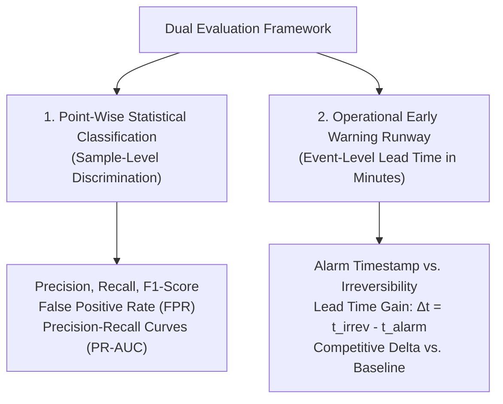

# Model Evaluation & Benchmark Scorecard

This document synthesizes the comparative evaluation framework, point-wise statistical performance, and operational early-warning lead times for the Naive Baseline, Isolation Forest, and LSTM-Autoencoder anomaly detectors.

---

## 1. Dual Evaluation Methodology

In industrial cold chains, an anomaly detector must be evaluated across two distinct, complementary dimensions:

### 1.1. Why PR-AUC Over ROC-AUC?
In severe class imbalance (where injected anomalous observations constitute $\approx 0.5\%$ of all sensor readings), standard Receiver Operating Characteristic (ROC) curves are deceptive. ROC curves measure True Positive Rate against False Positive Rate:

$$\text{FPR} = \frac{\text{FP}}{\text{FP} + \text{TN}}$$

Because the count of True Negatives ($\text{TN}$) exceeds 10,000 readings, a massive flood of false alarms ($\text{FP} = 2,000$) still yields an apparently respectable FPR of $16\%$, inflating ROC-AUC above $0.85$.

In contrast, **Precision-Recall (PR) curves** directly compare Precision against Recall:

$$\text{Precision} = \frac{\text{TP}}{\text{TP} + \text{FP}}$$

PR-AUC forces the model to penalize false alarms directly against real positive detections, providing an unvarnished metric of true operational alarm fidelity.

---

## 2. Point-Wise Statistical Performance (D35 Ground Truth)

Point-wise metrics are evaluated exclusively across the held-out chronological test partition ($t \ge \text{2018-10-29 11:10:48}$):

| Evaluation Metric | Out Series: Isolation Forest | Out Series: LSTM-Autoencoder | In Series: Isolation Forest | In Series: LSTM-Autoencoder |
| :--- | :--- | :--- | :--- | :--- |
| **Test Partition Size** | 13,372 rows | 13,343 rows* | 3,767 rows | 3,738 rows* |
| **Injected Positive Rows**| 65 | 65 | 23 | 23 |
| **True Positives (TP)** | 52 | 13 | 21 | 16 |
| **False Positives (FP)**| 6,067 | 2,722 | 1,010 | 106 |
| **True Negatives (TN)** | 7,240 | 10,556 | 2,734 | 3,609 |
| **False Negatives (FN)**| 13 | 52 | 2 | 7 |
| **Point-Wise Recall** | **80.00%** | 20.00% | **91.30%** | 69.57% |
| **Point-Wise Precision**| 0.85% | 0.48% | 2.04% | **13.11%** |
| **F1-Score** | 0.0168 | 0.0093 | 0.0398 | **0.2207** |
| **False Positive Rate** | 45.59% | 20.50% | 26.98% | **2.85%** |
| **PR-AUC (Continuous)** | **0.0676** | 0.0049 | 0.2371 | **0.3852** |

*\*Note: LSTM metrics exclude the 29 initial causal blind-spot rows.*

---

## 3. Early Warning Runway Formulation

Operational early warning lead time measures the physical intervention window available to logistics dispatchers before product spoilage becomes irreversible:

$$\text{Lead Time} = t_{\text{irrev}} - t_{\text{alarm}} \quad (\text{minutes})$$

Where:
- $t_{\text{irrev}}$ is the start of the first streak where temperature remains continuously above the baseline threshold for $\ge 10.0\text{ minutes}$ (`D_IRREV_MINUTES = 10.0`).
- $t_{\text{alarm}}$ is the earliest detection timestamp within the bounded search window $[t_{\text{onset}}, t_{\text{end}} + 60\text{ min}]$.

### 3.1. Competitive Advantage Delta ($\Delta \text{Lead Time}$)
Measures additional lead time gained over the Naive Baseline:

$$\Delta \text{Lead Time}_{\text{model}} = \text{Lead Time}_{\text{model}} - \text{Lead Time}_{\text{baseline}}$$

- $\Delta > 0$: Proactive early warning runway achieved.
- $\Delta = 0$: Synchronous detection with baseline excursion.
- $\Delta < 0$: Lagging detection (alarm triggered after baseline).
- $\text{None}$: Baseline never alerted (e.g., in-range sensor flatline).

---

## 4. Master Three-Way Comparison Scorecard (Test-Side Injections)

The 6 test-side synthetic injections constitute the authoritative scientific benchmark (`data/processed/three_way_comparison.csv`):

| Injection ID | Series | Fault Type | Irreversibility Timestamp | Baseline Lead Time | Isolation Forest Lead Time | LSTM-Autoencoder Lead Time | IF Delta vs. Baseline | LSTM Delta vs. Baseline | Evaluation Status |
| :--- | :--- | :--- | :--- | :--- | :--- | :--- | :--- | :--- | :--- |
| **`out_step_001`** | Out | Step | 2018-11-17 13:25:00 | 0.0 min | 0.0 min | 0.0 min | 0.0 min | 0.0 min | `ok` (Instant jump) |
| **`out_drift_009`** | Out | Drift | 2018-10-30 03:03:00 | 0.0 min | **64.0 min** | -14.0 min | **+64.0 min** | -14.0 min | `ok` (Early warning vs lag) |
| **`out_flatline_012`**| Out | Flatline | None (Below $\tau$) | None | Alert at 21:09 | Alert at 21:03 | **Advantage** | **Advantage** | `ok` (Baseline blind spot) |
| **`out_flatline_013`**| Out | Flatline | None (Below $\tau$) | None | Alert at 01:22 | None | **Advantage** | None | `never_flagged` (LSTM) |
| **`in_step_018`** | In | Step | 2018-12-07 17:14:00 | 0.0 min | 0.0 min | 0.0 min | 0.0 min | 0.0 min | `ok` (Instant jump) |
| **`in_drift_023`** | In | Drift | 2018-11-02 08:07:00 | 0.0 min | **11.0 min** | 0.0 min | **+11.0 min** | 0.0 min | `ok` (Early warning) |

---

## 5. Key Research Takeaways

1. **Isolation Forest is Superior for Incipient Drift:** On `out_drift_009`, Isolation Forest alerts at `01:59:00`, while the baseline doesn't trip until `03:03:00`—providing **1 hour and 4 minutes (+64.0 min)** of decisive action runway.
2. **LSTM Exhibits Sequence Memory Inertia:** On `out_drift_009`, the LSTM-Autoencoder alarms at `03:17:00` (14 minutes after irreversibility), suffering from **temporal lag** as the 30-reading sliding window takes time to fill with anomalous points.
3. **Sensor Flatlines Expose Static Blind Spots:** On `out_flatline_012`, the baseline fails completely because the sensor froze at normal ambient temperature. Both Isolation Forest and LSTM successfully flag the collapse of natural variance.
4. **Environment Entropy Dictates Deep Learning Viability:** In conditioned indoor settings (`In` series), LSTM-Autoencoder achieves a low FPR (2.85%) and superior PR-AUC (0.3852), demonstrating its viability in controlled thermal storage.

