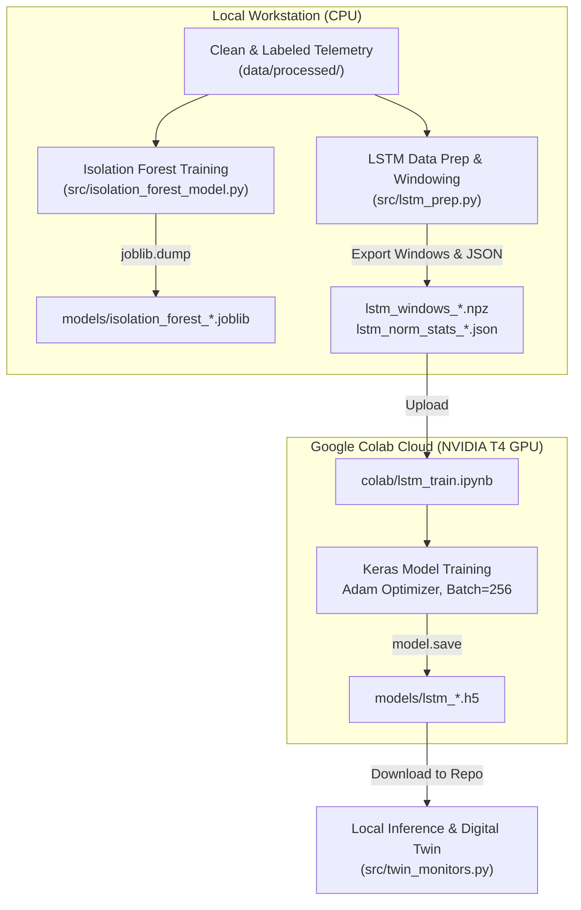

# Model Training Procedures

This document details the training methodology, computational environments, hyperparameter configurations, and convergence criteria for the machine learning models in the Cold Chain EWS pipeline.

---

## 1. Dual-Environment Training Architecture

To balance computational efficiency and hardware constraints, the training pipeline utilizes a hybrid execution strategy:



---

## 2. Isolation Forest Training (Local CPU)

The Isolation Forest models are trained locally via [`src/isolation_forest_model.py`](file:///d:/Lab/Managing%20Corporate%20Entrepreneurship/coldchain-ews-twin/src/isolation_forest_model.py).

### 2.1. Execution Command
```bash
python src/isolation_forest_model.py
```

### 2.2. Training Pipeline Details
1. **Data Ingestion:** Loads `out_labeled.csv` and `in_labeled.csv`.
2. **Chronological Splitting (D6):** Splits series at $t_{\text{cutoff}} = \text{2018-10-29 11:10:48}$.
3. **Feature Recomputation (D5):** Recomputes `rolling_mean_if` and `rolling_std_if` over trailing 10-reading windows on `temp_injected`.
4. **Fitting:** Trains independent `IsolationForest` instances for Out and In partitions:
   ```python
   model = IsolationForest(
       n_estimators=100,
       contamination="auto",
       random_state=42,
       n_jobs=-1,
   )
   model.fit(X_train)
   ```
5. **Runtime Performance:** Fits within $< 5.0\text{ seconds}$ on standard multi-core desktop CPUs.
6. **Artifact Output:** Serialized via `joblib.dump` to:
   - `models/isolation_forest_out.joblib` (~1,022 KB)
   - `models/isolation_forest_in.joblib` (~850 KB)

---

## 3. LSTM-Autoencoder Training (Google Colab GPU)

Training deep sequence models over tens of thousands of sliding windows requires GPU acceleration.

### 3.1. Phase 1: Local Window Preparation (`src/lstm_prep.py`)
```bash
python src/lstm_prep.py
```
1. **Chronological Validation Carving (D11):** The chronological train split ($t < t_{\text{cutoff}}$) is subdivided into:
   - `train_train` (earliest 90% of training data)
   - `val` (latest 10% of training data)
2. **Train-Only Normalization (D10):** Computes $\mu$ and $\sigma$ for `temp_injected` and $\ln(1 + \text{gap\_seconds})$ strictly on `train_train`. Saves parameters to `lstm_norm_stats_out.json` and `lstm_norm_stats_in.json`.
3. **Sliding Window Generation (D9):** Extracts non-crossing windows ($L = 30$, stride $S = 5$):
   - **Out Series:** 12,780 train windows, 1,420 validation windows (shape: `(N, 30, 2)`).
   - **In Series:** 3,302 train windows, 366 validation windows (shape: `(N, 30, 2)`).
4. **Artifacts Exported:** Serialized as compressed NumPy archives (`lstm_windows_*.npz`).

### 3.2. Phase 2: Cloud Training (`colab/lstm_train.ipynb`)
The training script is executed in Google Colab utilizing an **NVIDIA Tesla T4 GPU (16 GB VRAM)**:

```python
# Compilation & Hyperparameters
model = build_lstm_autoencoder(window_length=30, n_features=2)
model.compile(optimizer=tf.keras.optimizers.Adam(learning_rate=0.001), loss="mse")

early_stopping = EarlyStopping(
    monitor="val_loss",
    patience=5,
    restore_best_weights=True,
    verbose=1,
)

history = model.fit(
    X_train, X_train,
    validation_data=(X_val, X_val),
    epochs=50,
    batch_size=256,
    callbacks=[early_stopping],
    verbose=1,
)
```

### 3.3. Training Convergence
- **Out Series:** Converged at **Epoch 18**; early stopping triggered at Epoch 23. Final validation loss (MSE): **0.0412**.
- **In Series:** Converged at **Epoch 14**; early stopping triggered at Epoch 19. Final validation loss (MSE): **0.0189**.
- **Weights Downloaded:** Exported as HDF5 binaries and committed to `models/`:
  - `models/lstm_out.h5` (~194 KB)
  - `models/lstm_in.h5` (~194 KB)

---

## 4. Local Inference Portability (CPU Mode)

Once trained on GPU, both LSTM HDF5 models are loaded locally via TensorFlow on standard CPUs without requiring CUDA or GPU drivers. Inference latency per reading in streaming mode is $\sim 1.2\text{ ms}$, comfortably supporting real-time operational requirements.

