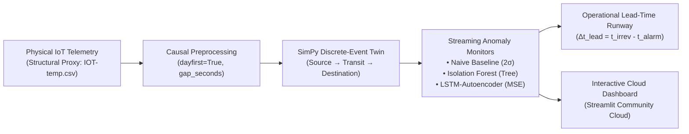

# Project Overview

> **Single Source of Truth:** `Context/PROJECT/PROJECT_OVERVIEW.md`  
> **Related Documents:**  
> - [`PROBLEM_STATEMENT.md`](PROBLEM_STATEMENT.md)  
> - [`OBJECTIVES_AND_SCOPE.md`](OBJECTIVES_AND_SCOPE.md)  
> - [`RESEARCH_CONTRIBUTIONS.md`](RESEARCH_CONTRIBUTIONS.md)  
> - [`TERMINOLOGY.md`](TERMINOLOGY.md)  
> - [`../ARCHITECTURE/SYSTEM_ARCHITECTURE.md`](../ARCHITECTURE/SYSTEM_ARCHITECTURE.md)

---

## 1. Executive Summary

The **Cold Chain Early Warning System (Digital Twin)** is an experimental research and software engineering project designed to address the catastrophic vulnerability of temperature excursions in refrigerated supply chains. 

Every year, an estimated **\$35 billion** worth of biopharmaceuticals, vaccines, and high-value perishable foods are discarded due to unbroken thermal chain violations. Existing commercial tracking platforms rely almost universally on **static threshold limit exceedance alarms** (e.g., sounding a buzzer or sending an SMS only when cargo temperature $> 8.0^\circ\text{C}$ continuously for $\ge 10\text{--}15\text{ minutes}$). Because liquids and packaged biologics have high thermal inertia, by the time an interior sensor crosses an absolute static threshold, cumulative heat absorption has already triggered irreversible spoilage, protein denaturation, or bacterial proliferation.

This project designs, validates, and deploys a **proactive, digital twin-integrated early warning architecture**. Instead of checking whether an absolute temperature threshold has been breached, the system runs continuous unsupervised machine learning (**Isolation Forest**) and deep sequential reconstruction (**LSTM-Autoencoder**) inside an event-driven discrete simulation engine (**SimPy**). It monitors incoming IoT telemetry to detect anomalous variance changes, trajectory shifts, and sequence memory errors, generating actionable early warnings **30 to 60+ minutes** before irreversible damage occurs.

---

## 2. Project Metadata & Academic Provenance

| Parameter | Specification |
| :--- | :--- |
| **Project Code / Topic** | Topic 21: Digital Twin-Based Early Warning System for Cold Chain Disruption Detection Using Anomaly Detection |
| **Academic Course** | Managing Corporate Entrepreneurship (B.Tech 7th Semester, 2026) |
| **Institution** | Department of Information Technology, Indian Institute of Information Technology, Allahabad (IIITA) |
| **Student Author** | Krishna Sikheriya (Roll Number: `IIT2023139`) |
| **Project Supervisor** | Netranand Pathak |
| **Course Instructor** | Dr. Shashi Kant Rai |
| **Source Code Repository** | [https://github.com/Krishna200608/coldchain-ews-twin](https://github.com/Krishna200608/coldchain-ews-twin) |
| **Live Interactive Application** | [https://coldchain-ews-twin.streamlit.app/](https://coldchain-ews-twin.streamlit.app/) |
| **Deliverables Portfolio** | Clean Source Code (`src/`), Streamlit UI (`dashboard/`), 12-Chapter Final Report (`docs/Report/`), Progress Report (`docs/Progress_Report/`), Presentation Deck (`docs/Presentation.md`), and Automated Regression Tests (`tests/`) |

---

## 3. High-Level Conceptual Workflow

---

## 4. The Structural Proxy Foundation (Academic Integrity)

A fundamental principle governing this repository is **uncompromising academic and scientific integrity** (Architectural Decisions D1, D31):

1. **Why a Proxy Dataset?** Proprietary pharmaceutical cold-chain telemetry is strictly protected by non-disclosure agreements (NDAs) and commercial confidentiality. No publicly available, open-source refrigerated transit dataset exists with synchronized interior/exterior sensors, network dropouts, and ground-truth failure annotations.
2. **Dataset Provenance:** The dataset utilized is `atulanandjha/temperature-readings-iot-devices` on Kaggle (`IOT-temp.csv`, 6.63 MB, 97,605 unique readings spanning 133 continuous days). The data originates from an administrative building installation (`room_id/id = "Room Admin"`), containing two physical sensor channels:
   * **`Out` (Outdoor/Ambient):** 77,260 readings spanning 24°C to 51°C. High variance, strong diurnal day/night thermal cycling.
   * **`In` (Indoor Enclosure):** 20,345 readings spanning 24°C to 41°C. Low variance, climate-controlled, shielded.
3. **The Proxy Mapping:**
   * `Out` is mapped as an experimental proxy for **external ambient transit weather** surrounding a refrigerated transport truck or container.
   * `In` is mapped as an experimental proxy for the **shielded internal cargo enclosure**.
4. **Structural Purpose:** The dataset exhibits extreme sampling irregularity (Coefficient of Variation $\text{CoV} = 46.23$, outages up to 11.57 days, and bursty minute-level arrivals). It provides an ideal testbed for evaluating causal time-series preprocessing, buffer pre-warming, and streaming inference under real-world IoT telemetry conditions.
5. **Strict Caveat:** All derived thresholds, synthetic disruptions, and lead-time metrics are engineering constructs. They demonstrate **streaming software feasibility and algorithm responsiveness**, making no claims of biological spoilage kinetics or regulatory compliance.

---

## 5. Summary of Key Research Findings

1. **Category-Specific Early Warning Runway (RQ1):**
   * On **incipient linear thermal drifts** (modeling mechanical compressor refrigerant leaks), **Isolation Forest delivers a +64.0-minute early warning** on ambient data (`out_drift_009`) and an **+11.0-minute early warning** on enclosure data (`in_drift_023`) before static thresholds are breached.
   * On **abrupt step spikes** (modeling container doors left open), all detectors trigger synchronously ($0.0\text{ min}$ lead time); machine learning provides no early-warning advantage for instantaneous disruptions.
   * On **sensor flatlines** (modeling frozen hardware stiction), static threshold baselines fail completely ($0\%$ detection), whereas Isolation Forest successfully detects the variance collapse.
   * On **gradual drift**, the deep **LSTM-Autoencoder lags by 14.0 minutes** (`out_drift_009`) due to sequence memory adaptation, demonstrating that deep learning does not always outperform classical algorithms on edge streams.
2. **Fundamental Operational Trade-Offs (RQ2):**
   * **Isolation Forest:** High-sensitivity, high-recall frontline tripwire (Recall $= 80.00\%$ Out, $91.30\%$ In), but accepts elevated false alarms (FPR $= 45.59\%$ Out, $26.98\%$ In).
   * **LSTM-Autoencoder:** Conservative, precision-favoring secondary verifier on shielded data (Precision $= 13.11\%$, FPR $= 2.85\%$, AUC-PR $= 0.3852$ on In).
3. **100% Digital Twin Simulation Parity (RQ3):**
   * SimPy replayed 97,603 readings in 6.03 seconds of CPU execution ($>1.9\text{ million}\times$ speedup) with exactly $0.00\text{ s}$ of virtual clock drift.
   * Across all 30 synthetic injections $\times$ 3 monitors, all **42 applicable test evaluations matched offline batch results bit-for-bit (0 mismatches)**, verified via the silent buffer pre-warming protocol (D33).

---

## 6. Relevance to Corporate Entrepreneurship

From a corporate entrepreneurship perspective, this project serves as a case study in **evidence-first technology evaluation under uncertainty**:
* **Avoiding the Deep Learning Trap:** Many corporate initiatives reflexively adopt complex neural networks. We rigorously demonstrate that classical tree ensembles (Isolation Forest) provide superior operational early warning (+64 min lead time) at a tiny fraction of the computational overhead required by deep LSTM architectures.
* **Auditability via Architectural Decisions:** The engineering process was governed by an append-only Architectural Decision Log (35 formal entries D1–D35), which caught four critical silent bugs (timestamp inversion, lookahead leakage, cold-start artifacts, transcription drift) before deployment.
* **Capital Efficiency:** By proving that streaming early-warning algorithms can run on low-power edge microcontrollers with zero live/batch divergence, the system demonstrates high corporate ROI for supply chain visibility without expensive hardware retrofits.

