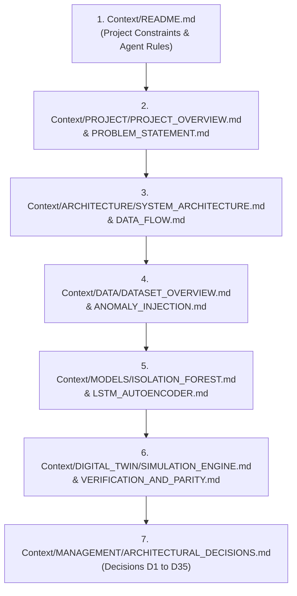

# Context Directory — Single Source of Truth (SSOT)

> **Repository:** [https://github.com/Krishna200608/coldchain-ews-twin](https://github.com/Krishna200608/coldchain-ews-twin)  
> **Project Title:** Digital Twin-Based Early Warning System for Cold Chain Disruption Detection Using Anomaly Detection  
> **Academic Context:** Course "Managing Corporate Entrepreneurship" (B.Tech 7th Semester, 2026), Department of Information Technology, Indian Institute of Information Technology, Allahabad (IIITA).  
> **Author:** Krishna Sikheriya (Roll Number: `IIT2023139`)  
> **Supervisor:** Netranand Pathak | **Instructor:** Dr. Shashi Kant Rai  
> **Public Deployment:** [https://coldchain-ews-twin.streamlit.app/](https://coldchain-ews-twin.streamlit.app/)

---

## 1. Project Identity

This project designs, evaluates, and deploys an experimental **Digital Twin-Integrated Early Warning System (EWS)** for detecting cold-chain thermal disruptions. 

Commercial refrigerated logistics platforms predominantly rely on **static threshold exceedance alarms** (e.g., alarming only when temperature $> 8.0^\circ\text{C}$ continuously for $\ge 10\text{--}15\text{ minutes}$). Under real operational dynamics, products suffer cumulative biochemical degradation before static limits are breached, rendering threshold alarms fundamentally **post-hoc**.

This repository embeds unsupervised classical machine learning (**Isolation Forest**) and deep sequence reconstruction (**LSTM-Autoencoder**) directly into an event-driven discrete-event simulation engine (**SimPy**). Operating over a virtual clock driven by real historical sensor inter-arrival gaps, the system detects subtle multidimensional and variance precursors—such as compressor mechanical wear, slow refrigerant leaks, and sensor stiction—delivering quantifiable early-warning runway ($\Delta t_{\text{lead}} = t_{\text{irreversibility}} - t_{\text{alarm}}$) before irreversible spoilage occurs.

> [!IMPORTANT]
> **Structural Proxy Dataset Notice (D1, D31):**  
> All physical telemetry originates from a generic IoT temperature sensor log (`IOT-temp.csv`, 97,605 unique records from Kaggle, room identifier `"Room Admin"`), **not** active pharmaceutical or refrigerated transit vehicles. The dataset is used strictly as an **experimental structural proxy** to stress-test irregular temporal arrivals ($\text{CoV} = 46.23$), data buffering, and embedded inference architectures. All derived thresholds, synthetic disruptions, and metrics are proxy constructs carrying no clinical or food-safety claims.

---

## 2. Mandatory Reading Order for AI Agents & Developers

Any AI agent, developer, or researcher entering this repository **must** read the documentation in the following sequence before proposing or executing code changes:



1. **Orientation:** [`Context/README.md`](README.md) (This file)
2. **Foundations:**
   * [`Context/PROJECT/PROJECT_OVERVIEW.md`](PROJECT/PROJECT_OVERVIEW.md)
   * [`Context/PROJECT/PROBLEM_STATEMENT.md`](PROJECT/PROBLEM_STATEMENT.md)
   * [`Context/PROJECT/TERMINOLOGY.md`](PROJECT/TERMINOLOGY.md)
3. **Architecture & Piping:**
   * [`Context/ARCHITECTURE/SYSTEM_ARCHITECTURE.md`](ARCHITECTURE/SYSTEM_ARCHITECTURE.md)
   * [`Context/ARCHITECTURE/DATA_FLOW.md`](ARCHITECTURE/DATA_FLOW.md)
   * [`Context/ARCHITECTURE/DIGITAL_TWIN_ARCHITECTURE.md`](ARCHITECTURE/DIGITAL_TWIN_ARCHITECTURE.md)
   * [`Context/ARCHITECTURE/DASHBOARD_ARCHITECTURE.md`](ARCHITECTURE/DASHBOARD_ARCHITECTURE.md)
4. **Data Strategy & Ground Truth:**
   * [`Context/DATA/DATASET_OVERVIEW.md`](DATA/DATASET_OVERVIEW.md)
   * [`Context/DATA/DATA_PREPROCESSING.md`](DATA/DATA_PREPROCESSING.md)
   * [`Context/DATA/ANOMALY_INJECTION.md`](DATA/ANOMALY_INJECTION.md)
5. **Detection Algorithms:**
   * [`Context/MODELS/BASELINE_DETECTOR.md`](MODELS/BASELINE_DETECTOR.md)
   * [`Context/MODELS/ISOLATION_FOREST.md`](MODELS/ISOLATION_FOREST.md)
   * [`Context/MODELS/LSTM_AUTOENCODER.md`](MODELS/LSTM_AUTOENCODER.md)
   * [`Context/MODELS/MODEL_EVALUATION.md`](MODELS/MODEL_EVALUATION.md)
6. **Simulation Engine:**
   * [`Context/DIGITAL_TWIN/SIMULATION_ENGINE.md`](DIGITAL_TWIN/SIMULATION_ENGINE.md)
   * [`Context/DIGITAL_TWIN/STREAMING_MONITORS.md`](DIGITAL_TWIN/STREAMING_MONITORS.md)
   * [`Context/DIGITAL_TWIN/VERIFICATION_AND_PARITY.md`](DIGITAL_TWIN/VERIFICATION_AND_PARITY.md)
7. **Empirical Benchmarks & Rules:**
   * [`Context/RESEARCH/RESULTS_AND_FINDINGS.md`](RESEARCH/RESULTS_AND_FINDINGS.md)
   * [`Context/MANAGEMENT/ARCHITECTURAL_DECISIONS.md`](MANAGEMENT/ARCHITECTURAL_DECISIONS.md)

---

## 3. Important Project Constraints & Rules

AI coding agents working on this codebase must strictly observe the following immutable constraints:

1. **Maintain Scientific Integrity (D31):** Never claim or imply that this software was trained on live pharmaceutical container data. Explicitly cite the proxy status in all documentation and UI layers.
2. **Never Interpolate on a Fixed Time Grid (D1):** Never resample telemetry to uniform 1-minute or 5-minute ticks. All features must be count-based (`ROLLING_WINDOW = 10` readings, `LSTM_WINDOW_LENGTH = 30` readings) to respect natural observation arrivals and avoid inventing fake temperatures across outages.
3. **Preserve Independent Series Decoupling (D2):** The `"Out"` (ambient) and `"In"` (enclosure proxy) series must remain strictly decoupled. Cross-series interactions are handled strictly via nearest-neighbor `in_out_diff` with a 15-minute tolerance cap (`MAX_MATCH_MINUTES = 15`).
4. **Never Overwrite Clean Feature Reference Data (D3, D4):** Clean feature files (`out_features.csv`, `in_features.csv`) must never contain injected anomalies. Anomaly injection occurs exclusively on copies (`out_labeled.csv`, `in_labeled.csv`).
5. **Zero Look-Ahead Leakage (D6, D11):** All splits are strictly **chronological** at `cutoff_ts = 2018-10-29 11:10:48` (70% train / 30% test). Standard random splitting or $k$-fold cross-validation is strictly forbidden as it shuffles future events into the past.
6. **No Test-Label Leakage in Thresholds (D7, D13):** Isolation Forest contamination must remain `contamination='auto'` (scikit-learn default heuristic). LSTM thresholds must be computed exclusively from train-split reconstruction errors (`mean + 2.0 * std`). Never tune thresholds to match the known test-injection fraction.
7. **Out-of-Sample Benchmark Discipline (D26):** Only the **6 test-side synthetic injections** count toward headline performance and early-warning claims. The 24 train-side injections serve strictly as software demonstrations of streaming throughput and must be marked as `[TRAIN DEMO]`.
8. **Single Source of Truth for Quantitative Metrics (D34, D35):** Point-wise metrics (TP, FP, TN, FN, Precision, Recall, F1, FPR, AUC-PR) must be loaded dynamically from `data/processed/*_pointwise_metrics.json`. Never hardcode floating-point evaluation claims in UI components or documentation.
9. **Zero Logic Duplication (D27):** Presentation layers (`dashboard/`) must never reimplement anomaly detection logic. All online detectors (`BaselineMonitor`, `IFMonitor`, `LSTMMonitor`) must be imported directly from `src/twin_monitors.py`.
10. **Preserve Bit-for-Bit Live/Batch Parity (D33):** Sub-window replays must silently pre-warm monitor buffers with preceding historical readings (10 readings for IF, 30 readings for LSTM) to guarantee exact match with offline batch evaluations.
11. **Display-Only Acceleration (D28):** Playback speed factors (`1x`, `5x`, `10x`, `25x`, `Instant`) must only adjust UI animation pacing. They must never alter the physical timestamps, `gap_seconds`, or feature magnitudes passed to model inference.
12. **Do Not Commit Secrets or API Keys:** Never commit `kaggle.json`, GitHub Personal Access Tokens (PATs), or environment secrets to git.
13. **Preserve Reproducibility (D3, D7):** Always set and preserve global seeds (`RANDOM_SEED = 42`, `IF_RANDOM_STATE = 42`).
14. **Update Documentation Alongside Architecture:** Whenever a core module or contract changes, update the corresponding file in `/Context` and log an entry in `Context/MANAGEMENT/CHANGELOG.md`.

---

## 4. Agent Workflow

When assigned a task in this repository, follow this execution protocol:

```text
[1. Read Context] ──> [2. Inspect Implementation] ──> [3. Formulate Plan]
        │
        └──> [4. Implement Cleanly] ──> [5. Run Automated Tests] ──> [6. Verify SSOT]
```

1. **Read:** Read `Context/README.md` and the specific module documentation in `/Context`.
2. **Inspect:** Examine the actual source code in `src/`, `dashboard/`, or `tests/`. Do not assume documentation is up to date if code contradicts it—code and verified JSON artifacts are authoritative.
3. **Plan:** Identify potential side effects on chronological splitting, rolling buffers, or metric serialization.
4. **Implement:** Write modular, maintainable, strictly typed Python 3.11 code adhering to PEP-8.
5. **Test:** Execute unit tests (`python -m unittest tests/test_d33_prewarm.py`) and ensure all assertions pass without warnings.
6. **Verify:** Check that live/batch parity and point-wise metrics remain internally consistent with `data/processed/`.
7. **Document:** Update the corresponding files under `/Context` to reflect modifications.

---

## 5. Master Index of the Context Knowledge Base

| Section | Document | Description |
| :--- | :--- | :--- |
| **PROJECT** | [`PROJECT_OVERVIEW.md`](PROJECT/PROJECT_OVERVIEW.md) | Executive project summary, purpose, identity, and academic framing |
| | [`PROBLEM_STATEMENT.md`](PROJECT/PROBLEM_STATEMENT.md) | Industrial cold-chain failure mechanics, post-hoc alarm trap, and research rationale |
| | [`OBJECTIVES_AND_SCOPE.md`](PROJECT/OBJECTIVES_AND_SCOPE.md) | Research questions (RQ1–RQ3), experimental scope, and explicit non-goals |
| | [`RESEARCH_CONTRIBUTIONS.md`](PROJECT/RESEARCH_CONTRIBUTIONS.md) | Summary of empirical contributions, lead-time discoveries, and novel twin architecture |
| | [`TERMINOLOGY.md`](PROJECT/TERMINOLOGY.md) | Standardized domain and engineering lexicon (Lead Time, Structural Proxy, etc.) |
| **ARCHITECTURE** | [`SYSTEM_ARCHITECTURE.md`](ARCHITECTURE/SYSTEM_ARCHITECTURE.md) | Comprehensive 6-stage end-to-end architecture and system flowchart |
| | [`REPOSITORY_STRUCTURE.md`](ARCHITECTURE/REPOSITORY_STRUCTURE.md) | Directory-by-directory inventory, artifact descriptions, and file naming conventions |
| | [`DATA_FLOW.md`](ARCHITECTURE/DATA_FLOW.md) | Detailed trace of data from raw CSV through preprocessing, twin, and UI |
| | [`MODULE_DEPENDENCIES.md`](ARCHITECTURE/MODULE_DEPENDENCIES.md) | Inter-module import graph, external dependency specifications, and coupling boundaries |
| | [`DIGITAL_TWIN_ARCHITECTURE.md`](ARCHITECTURE/DIGITAL_TWIN_ARCHITECTURE.md) | Discrete-event simulation architecture, SimPy processes, and virtual clock mechanics |
| | [`DASHBOARD_ARCHITECTURE.md`](ARCHITECTURE/DASHBOARD_ARCHITECTURE.md) | Streamlit application layout, component tree, reactive caching, and state management |
| **DATA** | [`DATASET_OVERVIEW.md`](DATA/DATASET_OVERVIEW.md) | Origin, volume, format, and physical provenance of the Kaggle IoT dataset |
| | [`DATA_ACQUISITION.md`](DATA/DATA_ACQUISITION.md) | Programmatic Kaggle API download workflow, credentials, and raw storage |
| | [`DATA_PREPROCESSING.md`](DATA/DATA_PREPROCESSING.md) | Day-first timestamp parsing, sorting, deduplication, and Out/In series splitting |
| | [`FEATURE_ENGINEERING.md`](DATA/FEATURE_ENGINEERING.md) | Mathematical formulation of `gap_seconds`, count-based rolling stats, and `in_out_diff` |
| | [`ANOMALY_INJECTION.md`](DATA/ANOMALY_INJECTION.md) | Synthetic disruption protocol, fault profiles (step, drift, flatline), and seed rules |
| | [`DATA_DICTIONARY.md`](DATA/DATA_DICTIONARY.md) | Exhaustive schema definition of all raw, interim, and processed CSV/JSON artifacts |
| **MODELS** | [`BASELINE_DETECTOR.md`](MODELS/BASELINE_DETECTOR.md) | Naive 2-sigma threshold baseline, single-reading alarm rule, and irreversibility construct |
| | [`ISOLATION_FOREST.md`](MODELS/ISOLATION_FOREST.md) | Unsupervised tree ensemble, contamination parameter, decision score, and PR curves |
| | [`LSTM_AUTOENCODER.md`](MODELS/LSTM_AUTOENCODER.md) | Recurrent sequence reconstruction architecture, count-based windowing, and causal MSE |
| | [`MODEL_TRAINING.md`](MODELS/MODEL_TRAINING.md) | Training workflows (local CPU for IF vs. Google Colab T4 GPU for LSTM) |
| | [`MODEL_EVALUATION.md`](MODELS/MODEL_EVALUATION.md) | Comparative evaluation methodology, lead-time formulation, and point-wise metrics |
| **DIGITAL TWIN** | [`SIMULATION_ENGINE.md`](DIGITAL_TWIN/SIMULATION_ENGINE.md) | SimPy engine execution, virtual timeline scheduling, and performance benchmarks |
| | [`EVENT_PROCESSING.md`](DIGITAL_TWIN/EVENT_PROCESSING.md) | Event packet schema, asynchronous inter-arrival dispatch, and transit queueing |
| | [`STREAMING_MONITORS.md`](DIGITAL_TWIN/STREAMING_MONITORS.md) | Destination sink monitor classes (`BaselineMonitor`, `IFMonitor`, `LSTMMonitor`) |
| | [`REPLAY_MECHANISM.md`](DIGITAL_TWIN/REPLAY_MECHANISM.md) | Continuous full-stream replay vs. jump-to-injection sub-window playback |
| | [`VERIFICATION_AND_PARITY.md`](DIGITAL_TWIN/VERIFICATION_AND_PARITY.md) | Proof of 100% bit-exact batch vs. live parity and buffer pre-warming protocol |
| **RESEARCH** | [`METHODOLOGY.md`](RESEARCH/METHODOLOGY.md) | Overarching scientific methodology, causal constraints, and structural proxy validity |
| | [`EXPERIMENTAL_DESIGN.md`](RESEARCH/EXPERIMENTAL_DESIGN.md) | Controlled experimental setup, seed 42 protocol, and train/test partition rationale |
| | [`EVALUATION_FRAMEWORK.md`](RESEARCH/EVALUATION_FRAMEWORK.md) | Dual evaluation paradigm: operational event lead-time vs. point-wise classifier metrics |
| | [`RESULTS_AND_FINDINGS.md`](RESEARCH/RESULTS_AND_FINDINGS.md) | Exact quantitative findings, lead-time table, confusion matrices, and parity records |
| | [`LIMITATIONS.md`](RESEARCH/LIMITATIONS.md) | Comprehensive threats to validity, single-sensor constraints, and proxy assumptions |
| | [`REPRODUCIBILITY.md`](RESEARCH/REPRODUCIBILITY.md) | Complete step-by-step reproduction instructions and deterministic verification checks |
| **DEVELOPMENT** | [`ENVIRONMENT_SETUP.md`](DEVELOPMENT/ENVIRONMENT_SETUP.md) | Python 3.11 virtual environment creation, dependencies, and platform notes |
| | [`EXECUTION_GUIDE.md`](DEVELOPMENT/EXECUTION_GUIDE.md) | Command-line execution instructions for every milestone pipeline step |
| | [`TESTING_GUIDE.md`](DEVELOPMENT/TESTING_GUIDE.md) | Unit test suite execution (`test_d33_prewarm.py`), assertions, and test philosophy |
| | [`CODING_CONVENTIONS.md`](DEVELOPMENT/CODING_CONVENTIONS.md) | PEP-8 compliance, typing standards, logging standards, and constant centralization |
| | [`TROUBLESHOOTING.md`](DEVELOPMENT/TROUBLESHOOTING.md) | Known errors, fixes, Kaggle authentication issues, and dependency caveats |
| **MANAGEMENT** | [`IMPLEMENTATION_STATUS.md`](MANAGEMENT/IMPLEMENTATION_STATUS.md) | Milestone-by-milestone implementation audit (M1 through M7) and deliverables inventory |
| | [`ARCHITECTURAL_DECISIONS.md`](MANAGEMENT/ARCHITECTURAL_DECISIONS.md) | Complete Architectural Decision Register detailing decisions D1 through D35 |
| | [`KNOWN_ISSUES.md`](MANAGEMENT/KNOWN_ISSUES.md) | Documented discrepancies, legacy warnings, and historical bug resolutions |
| | [`ROADMAP.md`](MANAGEMENT/ROADMAP.md) | Future research horizons, multi-sensor topologies, and hardware edge deployment |
| | [`CHANGELOG.md`](MANAGEMENT/CHANGELOG.md) | Chronological version history and architectural modification log |

