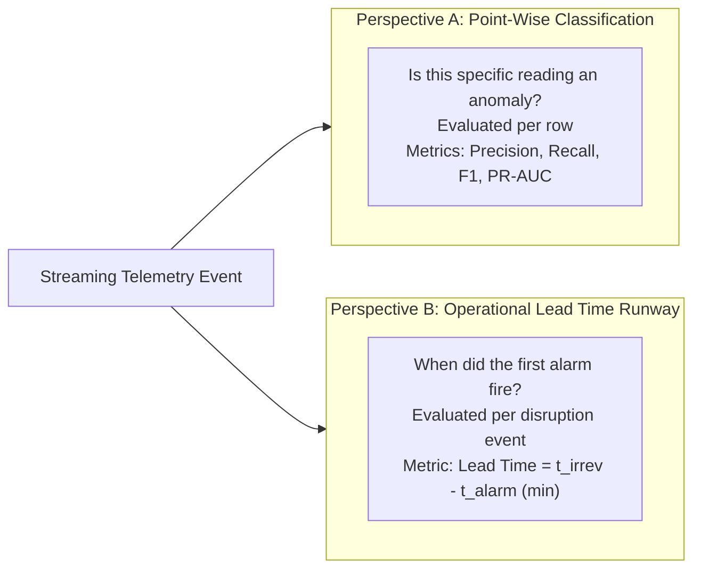

# Evaluation Framework & Metrics

This document formalizes the mathematical evaluation framework, detailing both point-wise classification metrics and event-level operational lead-time runways.

---

## 1. Dual Evaluation Perspectives

---

## 2. Point-Wise Statistical Metrics

Point-wise evaluation treats each individual sensor reading as an independent classification sample.

### 2.1. Confusion Matrix Definitions
- **True Positive (TP):** Observation falls inside an injection window (`is_injected_anomaly == True`) and detector flags an alarm.
- **False Positive (FP):** Observation is unperturbed nominal telemetry (`is_injected_anomaly == False`) but detector flags an alarm.
- **True Negative (TN):** Observation is nominal telemetry and detector does not flag an alarm.
- **False Negative (FN):** Observation is injected anomaly but detector fails to flag an alarm.

### 2.2. Metric Formulations

$$\text{Precision} = \frac{\text{TP}}{\text{TP} + \text{FP}}$$

$$\text{Recall} = \frac{\text{TP}}{\text{TP} + \text{FN}}$$

$$\text{F1-Score} = 2 \cdot \frac{\text{Precision} \cdot \text{Recall}}{\text{Precision} + \text{Recall}}$$

$$\text{False Positive Rate (FPR)} = \frac{\text{FP}}{\text{FP} + \text{TN}}$$

### 2.3. The 0.5% Class Imbalance Reality
In the held-out test partitions:
- **Out Series:** 65 positive rows out of 13,372 total rows (**0.486% positive prevalence**).
- **In Series:** 23 positive rows out of 3,767 total rows (**0.611% positive prevalence**).

Under extreme class imbalance:
- A false positive count of 1,000 on nominal data reduces point-wise precision to $\sim 2\%$, even when recall exceeds $90\%$.
- **Precision-Recall Area Under the Curve (PR-AUC)** serves as the authoritative metric because it evaluates precision across all possible operating thresholds without being inflated by large TN counts.

---

## 3. Operational Lead-Time Runway Metrics

In mission-critical cold chains, operators do not manage point-wise classifications; they manage **threat events**. An early warning system succeeds if it alerts dispatchers before irreversible damage occurs, regardless of whether every subsequent reading in the event is flagged.

### 3.1. Bounded Search Window
To prevent false temporal associations with future seasonal spikes:

$$\mathcal{W}_{\text{search}} = [t_{\text{onset}}, t_{\text{end}} + 60.0\text{ minutes}]$$

### 3.2. Alarm Timestamp ($t_{\text{alarm}}$)
The timestamp of the **first reading** flagged by the detector within $\mathcal{W}_{\text{search}}$:

$$t_{\text{alarm}} = \min \{ t \in \mathcal{W}_{\text{search}} \mid \text{Alarm}(t) = \text{True} \}$$

### 3.3. Proxy Irreversibility Timestamp ($t_{\text{irrev}}$)
The timestamp initiating the first continuous 10-minute streak above the baseline threshold:

$$\Delta t = t - t_{\text{streak\_start}} \ge 10.0\text{ minutes with } T(t) > \tau_{\text{baseline}}$$

If qualified, $t_{\text{irrev}} = t_{\text{streak\_start}}$.

### 3.4. Operational Lead Time & Competitive Delta

$$\text{Lead Time} = t_{\text{irrev}} - t_{\text{alarm}} \quad (\text{minutes})$$

$$\Delta \text{Lead Time}_{\text{ML}} = \text{Lead Time}_{\text{ML}} - \text{Lead Time}_{\text{baseline}}$$

- **$\Delta > 0$ (Early Warning Advantage):** The ML detector alerted dispatchers before the baseline excursion tripped.
- **$\Delta = 0$ (Synchronous):** The detector alerted at the exact same moment as the baseline.
- **$\Delta < 0$ (Lagging):** The detector suffered from temporal lag and fired after baseline irreversibility.
- **$\text{None}$ (Static Blind Spot):** The baseline failed to detect the fault entirely (e.g., in-range sensor flatline).

