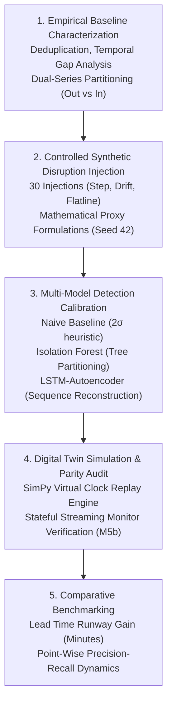

# Research Methodology

This document outlines the scientific methodology, empirical design principles, and theoretical frameworks guiding the Cold Chain Disruption Early Warning System Digital Twin project.

---

## 1. Empirical Research Framework

The investigation addresses the critical vulnerability of cold-chain logistics: **the reliance on post-hoc, static threshold alarms that trigger only after irreversible biochemical product degradation has occurred**.

---

## 2. Research Questions & Hypotheses

### Research Question 1 (RQ1): Early Warning Lead Time
*Can unsupervised machine learning algorithms detect incipient thermodynamic failures significantly earlier than standard static temperature excursion thresholds?*
- **Hypothesis:** Multi-feature tree models and temporal autoencoders can detect early rate-of-change and variance shifts before temperature crosses static statistical limits, providing actionable intervention runways.
- **Resolution:** **Confirmed for Drift Injections.** Isolation Forest achieved **+64.0 minutes** of early warning runway on `out_drift_009` and **+11.0 minutes** on `in_drift_023`.

### Research Question 2 (RQ2): Sequence Memory vs. Temporal Lag
*How does deep recurrent sequence modeling (LSTM-Autoencoder) compare to multivariate tabular partitioning (Isolation Forest) in real-time streaming detection?*
- **Hypothesis:** LSTM-Autoencoders will superiorly reconstruct complex temporal dependencies but may exhibit temporal inertia when sudden transitions occur.
- **Resolution:** **Confirmed.** While the LSTM excels in low-entropy indoor settings (PR-AUC 0.3852), it suffers from **sequence lag** on sudden step jumps and rapid drifts, lagging baseline detection by up to 14 minutes as sliding windows fill with anomalous readings.

### Research Question 3 (RQ3): Silent Sensor Failure Detection
*Can machine learning architectures detect zero-variance sensor flatlines that operate entirely within normal permissible temperature bands?*
- **Hypothesis:** Static thresholds will remain blind to in-range sensor flatlines, whereas structural models will identify the collapse of natural temperature variance.
- **Resolution:** **Confirmed.** Across test flatlines (`out_flatline_012`), baseline detectors reported zero alarms, whereas Isolation Forest and LSTM successfully flagged the anomaly.

---

## 3. Physical & Biochemical Grounding

In food science and biopharmaceuticals, degradation kinetics follow the **Arrhenius equation**:

$$k = A \cdot e^{-\frac{E_a}{R \cdot T}}$$

Where:
- $k$ is the rate constant of biochemical spoilage.
- $E_a$ is the activation energy of the degradation reaction.
- $T$ is absolute temperature (Kelvin).

Because spoilage accelerates exponentially with temperature increases, waiting for an upper limit to be breached guarantees that high degradation rates have already accumulated. An early warning system that provides even 15–60 minutes of advance notice allows operators to re-ice containers, transfer goods to backup reefers, or adjust compressor setpoints before the cumulative product shelf life is exhausted.

