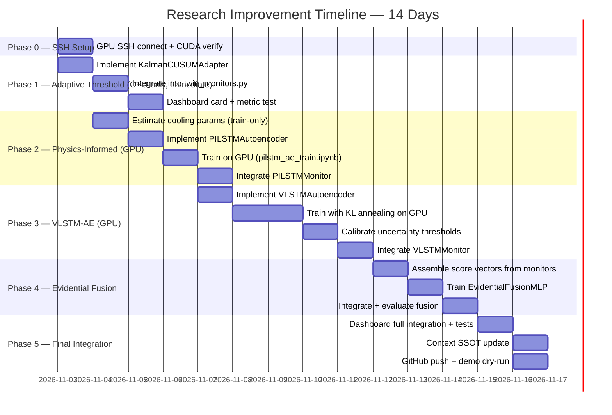

# AI Agent Handoff Document — Cold Chain EWS Research Improvement Plan

> **Purpose:** This document is the complete operational handoff for any AI agent (Claude, GPT-4o, Gemini, etc.) or human developer continuing research improvements on this project. If the previous agent's context is exhausted, start here. This file is the single master reference — do not rely on conversation history.
>
> **Repository:** `https://github.com/Krishna200608/coldchain-ews-twin`  
> **Author:** Krishna Sikheriya — Roll No: `IIT2023139` — B.Tech 7th Sem, IIITA  
> **Course:** Managing Corporate Entrepreneurship  
> **Supervisor:** Netranand Pathak | **Instructor:** Dr. Shashi Kant Rai  
> **Deadline:** < 2 weeks from this document's creation (2026-11-02)  
> **Goal:** Course project grade — novel improvements that impress in viva demo + written report  
> **GPU:** NVIDIA RTX 5000 Ada Generation, 32 GB VRAM (via SSH, not yet connected)  
> **Framework:** PyTorch (new models); existing LSTM-AE is Keras/TensorFlow — keep as-is

---

## MANDATORY READING ORDER FOR ANY AI AGENT

Before writing a single line of code, read in this exact sequence:

1. `Context/README.md` — Project constraints and D1–D35 rules
2. `Context/MANAGEMENT/ARCHITECTURAL_DECISIONS.md` — All 35 immutable decisions
3. `Context/MODELS/LSTM_AUTOENCODER.md` — Existing model architecture
4. `Context/RESEARCH/LIMITATIONS.md` — Verified gaps to exploit
5. `docs/AD_LOG.md` — Full architectural decision log (reverse chronological)
6. **This file** (`docs/RESEARCH_HANDOFF.md`) — The improvement plan

> [!CAUTION]
> Never modify `data/processed/out_features.csv` or `data/processed/in_features.csv`. Never use random train/test splits. Never tune thresholds from test labels. Read D1–D35 before any implementation.

---

## Part 1 — Project State as of 2026-11-02

### 1.1 Repository Structure

```
coldchain-ews-twin/
├── Context/                    # SSOT — 44 markdown files covering entire system
│   ├── README.md               # MANDATORY: read first — all agent rules here
│   ├── PROJECT/
│   ├── ARCHITECTURE/
│   ├── DATA/
│   ├── MODELS/
│   ├── DIGITAL_TWIN/
│   ├── RESEARCH/
│   ├── DEVELOPMENT/
│   └── MANAGEMENT/
├── src/                        # Core pipeline Python scripts
│   ├── config.py               # All named constants (SINGLE SOURCE OF TRUTH)
│   ├── data_acquisition.py     # Kaggle download of IOT-temp.csv
│   ├── preprocessing.py        # Cleaning, feature engineering (out/in split)
│   ├── anomaly_injection.py    # Synthetic step/drift/flatline injection
│   ├── baseline_and_labels.py  # Naive 2σ baseline detector
│   ├── isolation_forest_model.py # IF training + scoring
│   ├── lstm_prep.py            # Sliding window preparation (30×2 arrays)
│   ├── lstm_evaluation.py      # LSTM inference + threshold calibration
│   ├── if_evaluation.py        # IF PR-curve + injection-level evaluation
│   ├── three_way_comparison.py # Lead-time comparison across 3 detectors
│   ├── twin_monitors.py        # Live streaming monitors (Baseline, IF, LSTM)
│   ├── twin_crosscheck.py      # Batch vs. live parity verification
│   ├── twin_verification.py    # Verification utilities
│   ├── digital_twin.py         # SimPy source/transit/destination processes
│   └── split_utils.py          # Chronological split utilities
├── dashboard/
│   ├── app.py                  # Streamlit entry point
│   ├── replay_engine.py        # Live replay simulation
│   ├── data_loader.py          # Cached data loading
│   ├── constants.py
│   └── components/             # UI modules (alert_log, banners, showcase, etc.)
├── models/
│   ├── lstm_out.h5             # Keras LSTM-AE, Out series (12,866 params)
│   ├── lstm_in.h5              # Keras LSTM-AE, In series (12,866 params)
│   ├── isolation_forest_out.joblib
│   └── isolation_forest_in.joblib
├── data/processed/             # All derived artifacts — see Section 1.4
├── tests/
│   └── test_d33_prewarm.py     # 18-assertion parity test (must pass after any monitor change)
├── colab/                      # Jupyter notebooks for Colab GPU training
├── docs/
│   ├── AD_LOG.md               # Architecture decisions log (D1–D35)
│   ├── RESEARCH_HANDOFF.md     # THIS FILE
│   └── ...
├── requirements.txt
└── .venv/                      # Python 3.11 virtual environment (do not modify)
```

### 1.2 Environment

| Item | Value |
|------|-------|
| Python | 3.11 |
| Venv | `.venv/` at repo root |
| Activate (Windows) | `.venv\Scripts\activate` |
| Activate (Linux/SSH) | `source .venv/bin/activate` |
| Key libraries | `tensorflow>=2.16`, `scikit-learn`, `simpy`, `streamlit>=1.33`, `joblib`, `pandas`, `numpy`, `altair` |
| Run dashboard | `streamlit run dashboard/app.py` |
| Run tests | `python -m unittest tests/test_d33_prewarm.py` |
| GPU (SSH) | RTX 5000 Ada, 32 GB VRAM — **not yet connected** |
| New models framework | **PyTorch** (`torch`, `pytorch-forecasting`) |

### 1.3 Existing Model Architecture — CONFIRMED

The existing LSTM-Autoencoder (Keras, `models/lstm_out.h5` and `models/lstm_in.h5`):

```
Layer                        Output Shape        Params
─────────────────────────────────────────────────────────
encoder_lstm (LSTM)          (None, 32)           4,480
bottleneck_repeat (Repeat)   (None, 30, 32)           0
decoder_lstm (LSTM)          (None, 30, 32)       8,320
reconstruction_dense (TD)    (None, 30, 2)           66
─────────────────────────────────────────────────────────
Total trainable params: 12,866
```

- **Input:** `[30 readings × 2 features]` where features = `[temp_injected_norm, log_gap_seconds_norm]`
- **Normalization:** z-score using train-split stats from `data/processed/lstm_norm_stats_{out,in}.json`
- **Score:** MSE at the **last timestep only** — `mean((pred[0, -1, :] - window[0, -1, :])**2)`
- **Thresholds:** Out = `1.010091`, In = `1.512753` (train causal mean + 2σ, D13)
- **Training hardware:** Tesla T4 (Colab) — Out: 45 epochs/30.31s; In: 46 epochs/14.53s

**Out series normalization stats:**
```json
{
  "temp_injected_mean": 35.68003853096587,
  "temp_injected_std": 5.950910598500125,
  "log_gap_seconds_mean": 0.9894990680764548,
  "log_gap_seconds_std": 1.9985174353346589
}
```

### 1.4 Verified Benchmark Metrics (Ground Truth — NEVER fabricate these)

**Isolation Forest (6 test injections only — D26):**

| Series | TP | FP | TN | FN | Precision | Recall | FPR | PR-AUC |
|--------|----|----|----|----|-----------|--------|-----|--------|
| Out | 52 | 6067 | 7240 | 13 | 0.85% | 80.0% | 45.59% | 0.0676 |
| In | 21 | 1010 | 2734 | 2 | 2.04% | 91.30% | 26.98% | 0.2371 |

**LSTM-Autoencoder (6 test injections only — D26):**

| Series | TP | FP | TN | FN | Precision | Recall | FPR | PR-AUC |
|--------|----|----|----|----|-----------|--------|-----|--------|
| Out | 13 | 2722 | 10556 | 52 | 0.48% | 20.0% | 20.50% | 0.0049 |
| In | 16 | 106 | 3609 | 7 | 13.11% | 69.57% | 2.85% | 0.3852 |

**Three-Way Lead Time Comparison (test injections only):**

| Injection | Type | Baseline Lead | IF Lead | LSTM Lead |
|-----------|------|---------------|---------|-----------|
| `out_step_001` | step | 0.0 min | 0.0 min | 0.0 min |
| `out_drift_009` | drift | 0.0 min | **+64.0 min** | **−14.0 min** |
| `out_flatline_012` | flatline | NaN | alarm fired | alarm fired |
| `out_flatline_013` | flatline | NaN | alarm fired | never flagged |
| `in_step_018` | step | 0.0 min | 0.0 min | 0.0 min |
| `in_drift_023` | drift | 0.0 min | +11.0 min | 0.0 min |

### 1.5 Key Config Constants (from `src/config.py`)

```python
ROLLING_WINDOW       = 10      # IF rolling buffer size (count-based — D1)
LSTM_WINDOW_LENGTH   = 30      # LSTM sliding window (count-based — D1)
LSTM_WINDOW_STRIDE   = 5       # Window stride
LSTM_VAL_FRACTION    = 0.1     # Val slice from train tail
TRAIN_FRACTION       = 0.7     # Chronological split (D6)
RANDOM_SEED          = 42      # All reproducible ops
K_SIGMA              = 2.0     # Baseline/LSTM threshold sigma
MAX_MATCH_MINUTES    = 15      # Cross-series matching cap
SEARCH_HORIZON_MINUTES = 60.0  # Window to search for alarm after injection
TRANSIT_LATENCY_SECONDS = 0.0  # SimPy stage delay (keep at 0.0 — D19)
cutoff_ts = "2018-10-29 11:10:48"  # Chronological split boundary (D6)
```

### 1.6 Data Files

| File | Description |
|------|-------------|
| `data/processed/out_features.csv` | Clean Out-series features (NEVER overwrite) |
| `data/processed/in_features.csv` | Clean In-series features (NEVER overwrite) |
| `data/processed/out_labeled.csv` | Out with injected anomalies + labels |
| `data/processed/in_labeled.csv` | In with injected anomalies + labels |
| `data/processed/injection_log.csv` | Audit trail of all 30 injections |
| `data/processed/injection_train_test_status.csv` | train/test label per injection |
| `data/processed/lstm_norm_stats_{out,in}.json` | Train-only normalization stats |
| `data/processed/lstm_windows_{out,in}_train.npz` | Pre-built training windows |
| `data/processed/lstm_windows_{out,in}_val.npz` | Pre-built validation windows |
| `data/processed/if_scores_{out,in}.csv` | IF decision scores for all rows |
| `data/processed/lstm_evaluation.csv` | LSTM injection-level evaluation |
| `data/processed/three_way_comparison.csv` | Lead-time table (all 3 detectors) |
| `data/processed/twin_crosscheck_report.csv` | Batch vs. live parity (42 checks) |
| `data/processed/twin_alarms_{baseline,if,lstm}_{out,in}.csv` | Live alarm records |

---

## Part 2 — Immutable Constraints (D1–D35 Summary)

> [!IMPORTANT]
> These constraints are **non-negotiable**. Violating any one of them invalidates the scientific integrity of the project.

| ID | Constraint | What NOT to do |
|----|-----------|----------------|
| D1 | Count-based windows only — no time grid | Never resample to 1-min ticks |
| D2 | Out and In are strictly independent series | No cross-series model input |
| D3/D4 | Clean feature CSVs never overwritten | Never write anomalies into `*_features.csv` |
| D5 | Rolling features recomputed from `temp_injected`, `in_out_diff` excluded from IF/LSTM | Don't use stale pre-injection rolling stats |
| D6 | Chronological split at `cutoff_ts` only | No k-fold, no random shuffle |
| D7 | IF `contamination='auto'` (untuned) | Never set contamination to known anomaly fraction |
| D13 | LSTM threshold = train causal mean + 2σ | Never tune to test labels |
| D19 | `TRANSIT_LATENCY_SECONDS = 0.0` | Don't add artificial latency |
| D23 | Continuous monitor buffers — no reset at split boundaries | Buffer must span train→val→test |
| D24 | Baseline uses whole-series threshold; IF/LSTM use train-only | Don't mix threshold regimes |
| D26 | Only 6 test injections = scientific benchmark | Never present train-side alarms as performance claims |
| D27 | No model logic in dashboard — import from `src/twin_monitors.py` | Don't reimplement monitor logic in `app.py` |
| D28 | Playback speed is display-only | Never scale timestamps or features by speed factor |
| D31 | Structural proxy notice everywhere | Never claim real cold-chain data |
| D33 | Buffer pre-warming in jump-to-injection mode | Don't cold-start buffers at arbitrary indices |
| D34/D35 | Metrics loaded from JSON/CSV dynamically | Never hardcode floating-point metrics in UI |

---

## Part 3 — Identified Research Gaps (Verified Against Actual Code)

| Gap ID | Gap Description | Evidence Location | Root Cause |
|--------|----------------|-------------------|------------|
| G1 | IF Out FPR = 45.59% | `data/processed/if_pointwise_metrics.json` | High ambient entropy overwhelms isolation scoring |
| G2 | LSTM lag: −14 min on `out_drift_009` | `data/processed/three_way_comparison.csv` | 30-reading window inertia; reactive reconstruction |
| G3 | LSTM uses only 2 features despite richer feature set available | `src/lstm_prep.py` L187–190 | `in_out_diff` excluded (D5), `rolling_std` not fed to LSTM |
| G4 | Static normalization from train period only | `src/lstm_prep.py` L157–168 | Fixed µ/σ; distributional shift across time unhandled |
| G5 | No uncertainty quantification | `src/twin_monitors.py` L283–296 | Deterministic MSE score, single-point alarm |
| G6 | Fixed 2σ threshold, never adapts | `src/config.py` L42 + `lstm_evaluation.py` | Hard-coded; no online recalibration |
| G7 | 3 detectors operate independently, never fused | `src/twin_monitors.py` L332–335 | No combination layer exists |
| G8 | RepeatVector collapses all temporal context to one vector | `models/lstm_out.h5` architecture | `LSTM(32) → RepeatVector(30)` — fixed bottleneck |
| G9 | MSE loss cannot distinguish sensor spikes from real excursions | `src/twin_monitors.py` L284–285 | No physics constraint in loss function |
| G10 | LSTM cold-start blind spot: first 29 readings = NaN | `src/twin_monitors.py` L273–275 | Window buffer fill-up requirement |

---

## Part 4 — Research Proposals (Priority-Adjusted for < 2-Week Deadline)

### Critical Constraint: Solo developer, < 2 weeks, course demo + viva

**Revised Priority Stack:**

| Priority | Proposal | Effort | Impact | Demo-Visible? |
|----------|----------|--------|--------|---------------|
| 🥇 **P4** | Adaptive Threshold (Kalman + CUSUM) | 2–3 days | High FPR reduction | ✅ Yes — new metric card |
| 🥈 **P2** | Physics-Informed Loss (PILSTM-AE) | 2–3 days | Spike disambiguation | ✅ Yes — new alarm category |
| 🥉 **P1** | Variational LSTM-AE (VLSTM-AE) | 3–4 days | Uncertainty scores | ✅ Yes — confidence interval on chart |
| 4th | **P5** | Evidential Fusion (EDL) | 3–4 days | Best combined PR-AUC | ✅ Yes — fused confidence column |
| 5th | **P3** | TFT Forecaster | 5–7 days | Proactive forecasting | ✅ Yes — trajectory plot |

> [!TIP]
> **Recommended 2-week execution:** P4 (days 1–3) + P2 (days 2–4 in parallel on GPU) + P1 (days 4–7) + P5 (days 8–11) + dashboard integration (days 12–14). Skip P3 if time is tight — it's the largest effort.

---

### P4 — Online Adaptive Threshold via Kalman Filter + CUSUM

**Addresses:** G4, G6 | **GPU needed:** No | **Days:** 2–3

#### Why This First
- CPU-only implementation → can start immediately without SSH setup
- Delivers immediate, measurable FPR reduction → visible in demo
- Blocks nothing; can be developed in parallel with other proposals

#### What It Does
Replaces the fixed train-time `mean + 2σ` threshold with an online self-updating threshold that tracks distributional shift in the anomaly score stream.

#### Mathematical Specification

**Kalman Filter — Running Score Statistics:**

$$\hat{\mu}_t = \hat{\mu}_{t-1} + K_t \cdot (s_t - \hat{\mu}_{t-1})$$

$$K_t = \frac{P_{t-1}}{P_{t-1} + R}, \quad P_t = (1 - K_t) \cdot P_{t-1}$$

- $s_t$ = anomaly score at time $t$ (IF decision score or LSTM MSE)
- $R$ = measurement noise variance (set to `0.01` initially; tune if needed)
- Initialize: $\hat{\mu}_0$ = train causal mean (from existing JSON stats), $P_0 = 1.0$

**CUSUM Chart — Drift Alarm:**

$$C_t^+ = \max(0,\ C_{t-1}^+ + s_t - \hat{\mu}_t - k)$$
$$C_t^- = \max(0,\ C_{t-1}^- - s_t + \hat{\mu}_t - k)$$

- $k$ = allowance (slack) = `0.5 × σ_train` (from norm stats JSON)
- $h$ = decision interval = `4.0 × σ_train` (tune via validation set)
- Alarm when `C_t+ > h` OR `C_t- > h`

**Adaptive Threshold Update (contamination guard):**

```python
# Only update Kalman state if current score is below current adaptive threshold
# Prevents anomalies from shifting the threshold upward (contamination guard)
if s_t < adaptive_threshold_t:
    update_kalman(s_t)
adaptive_threshold_t = kalman_mean_t + 2.0 * kalman_std_t
```

#### Implementation

**New file:** `src/adaptation/adaptive_threshold.py`

```python
"""
src/adaptation/adaptive_threshold.py
=====================================
Online adaptive anomaly threshold using Kalman Filter + CUSUM control chart.

Constraints obeyed:
- D1: No time-grid assumption; works on count-based event stream
- D6: Kalman initialized from train-split stats (no test leakage)
- D13: Original fixed threshold preserved for benchmark comparison

Usage:
    from src.adaptation.adaptive_threshold import KalmanCUSUMAdapter
    adapter = KalmanCUSUMAdapter(
        init_mean=train_causal_mean,   # from lstm_norm_stats JSON
        init_std=train_causal_std,     # from lstm_norm_stats JSON
        k_sigma=2.0,                   # same as K_SIGMA in config.py
        measurement_noise_R=0.01,
        cusum_slack_factor=0.5,
        cusum_decision_factor=4.0
    )
    # Per reading:
    result = adapter.update(score=s_t)
    # result.adaptive_threshold  → current threshold
    # result.cusum_alarm         → True if CUSUM detects drift
    # result.is_stable           → False if Kalman not yet converged
```

**Class skeleton:**

```python
from dataclasses import dataclass
import numpy as np

@dataclass
class AdaptiveThresholdResult:
    adaptive_threshold: float
    kalman_mean: float
    kalman_std: float
    cusum_plus: float
    cusum_minus: float
    cusum_alarm: bool
    is_stable: bool  # True after min 30 normal readings seen

class KalmanCUSUMAdapter:
    def __init__(self, init_mean, init_std, k_sigma=2.0,
                 measurement_noise_R=0.01,
                 cusum_slack_factor=0.5,
                 cusum_decision_factor=4.0):
        self.mu = init_mean
        self.sigma = init_std
        self.k_sigma = k_sigma
        self.P = 1.0               # Kalman error covariance
        self.R = measurement_noise_R
        self.k = cusum_slack_factor * init_std
        self.h = cusum_decision_factor * init_std
        self.C_plus = 0.0
        self.C_minus = 0.0
        self._n_stable_updates = 0

    def update(self, score: float) -> AdaptiveThresholdResult:
        adaptive_thr = self.mu + self.k_sigma * self.sigma
        # Contamination guard: only update Kalman on non-anomalous readings
        if score < adaptive_thr:
            K = self.P / (self.P + self.R)
            self.mu = self.mu + K * (score - self.mu)
            # Variance update (running estimate)
            self.sigma = max(1e-6, self.sigma * 0.99 + abs(score - self.mu) * 0.01)
            self.P = (1 - K) * self.P
            self._n_stable_updates += 1
        # CUSUM update
        self.C_plus  = max(0.0, self.C_plus  + score - self.mu - self.k)
        self.C_minus = max(0.0, self.C_minus - score + self.mu - self.k)
        cusum_alarm = (self.C_plus > self.h) or (self.C_minus > self.h)
        if cusum_alarm:  # Reset CUSUM after alarm
            self.C_plus = 0.0
            self.C_minus = 0.0
        return AdaptiveThresholdResult(
            adaptive_threshold=self.mu + self.k_sigma * self.sigma,
            kalman_mean=self.mu, kalman_std=self.sigma,
            cusum_plus=self.C_plus, cusum_minus=self.C_minus,
            cusum_alarm=cusum_alarm,
            is_stable=self._n_stable_updates >= 30
        )
```

**Integration into `src/twin_monitors.py`:**
- `LSTMMonitor.process_event()` — instantiate `KalmanCUSUMAdapter` in `__init__`; call `adapter.update(score)` after computing MSE; emit both fixed threshold alarm AND adaptive threshold alarm in record
- `IFMonitor.process_event()` — same; note IF uses negative-side decision score (negate before passing to adapter)

**Dashboard:** Add "Adaptive vs. Fixed Threshold" toggle in detector cards section

---

### P2 — Physics-Informed LSTM-AE (PILSTM-AE)

**Addresses:** G9, G1 | **GPU needed:** Yes (RTX 5000 Ada for training) | **Days:** 2–3

#### Why Physics
The current MSE loss cannot distinguish a 10°C instantaneous sensor spike (electrically induced, physically impossible) from a genuine temperature drift. Newton's Law of Cooling tells us that `dT/dt` is bounded by the thermal mass of the system. Exceeding this physical rate → sensor artifact, not excursion.

#### Mathematical Specification

**Newton's Law of Cooling for discrete irregular intervals (D1 compliant):**

$$\hat{\delta}_t = \frac{T_{t+1} - T_t}{\Delta t_t} \approx -k(T_t - T_{\text{amb}})$$

where $\Delta t_t = \text{gap\_seconds}_t$ (directly from existing feature, no resampling).

**Physics-Informed Loss:**

$$\mathcal{L}_{\text{total}} = \underbrace{\mathcal{L}_{\text{MSE}}}_{\text{reconstruction}} + \lambda \cdot \underbrace{\left\| \hat{\delta}^{\text{pred}}_t - \hat{\delta}^{\text{physics}}_t \right\|^2}_{\text{thermodynamic residual}}$$

where:
- $\hat{\delta}^{\text{pred}}_t$ = predicted rate of change from decoder output
- $\hat{\delta}^{\text{physics}}_t = -k(T_t - T_{\text{amb}})$ = physically expected rate
- $\lambda = 0.1$ initially (tune on validation PR-AUC)
- $k$ = cooling constant estimated from training data (L-BFGS fit; **train-only, no test leakage**)
- $T_{\text{amb}}$ = ambient temperature = rolling 100-reading median of `temp_injected` (train-only)

**Spike Classification:** A reading where $|\hat{\delta}_t| > 3\sigma_\delta$ (from training distribution of $\hat{\delta}$) is classified as `SENSOR_ARTIFACT` rather than `TEMPERATURE_EXCURSION`.

#### Implementation

**New file:** `src/models/pilstm_ae.py` — PyTorch module

```python
"""
src/models/pilstm_ae.py
=======================
Physics-Informed LSTM-Autoencoder for cold-chain anomaly detection.

Architecture: Same as existing Keras LSTM-AE but in PyTorch with physics loss.
    Encoder: LSTM(2→32, batch_first=True) — takes last hidden state
    Bottleneck: RepeatVector(hidden_dim, window_length)
    Decoder: LSTM(32→32, batch_first=True, return_sequences=True)
    Output: Linear(32→2) applied at each timestep

Physics loss: Newton's Law of Cooling residual, weighted by lambda_physics.
    Constraint: Only applied to temperature feature (index 0 of the 2 features)
    Gap seconds available from feature index 1 (log_gap_seconds_norm)
    Must un-normalize before physics computation (use saved norm stats JSON)

D1 compliance: gap_seconds is already in the feature vector; no resampling.
D6 compliance: cooling constant k estimated from train rows only.
"""

import torch
import torch.nn as nn

class PILSTMAEEncoder(nn.Module):
    def __init__(self, input_size=2, hidden_size=32):
        super().__init__()
        self.lstm = nn.LSTM(input_size, hidden_size, batch_first=True)

    def forward(self, x):  # x: (B, L, 2)
        _, (h_n, _) = self.lstm(x)
        return h_n[-1]     # (B, 32)

class PILSTMAEDecoder(nn.Module):
    def __init__(self, hidden_size=32, output_size=2, window_length=30):
        super().__init__()
        self.window_length = window_length
        self.lstm = nn.LSTM(hidden_size, hidden_size, batch_first=True)
        self.linear = nn.Linear(hidden_size, output_size)

    def forward(self, z):  # z: (B, 32)
        z_rep = z.unsqueeze(1).repeat(1, self.window_length, 1)  # (B, L, 32)
        out, _ = self.lstm(z_rep)
        return self.linear(out)  # (B, L, 2)

class PILSTMAutoencoder(nn.Module):
    def __init__(self, input_size=2, hidden_size=32, window_length=30):
        super().__init__()
        self.encoder = PILSTMAEEncoder(input_size, hidden_size)
        self.decoder = PILSTMAEDecoder(hidden_size, input_size, window_length)

    def forward(self, x):
        z = self.encoder(x)
        return self.decoder(z)

def physics_informed_loss(
    x_norm,       # (B, L, 2) — normalized input
    x_hat_norm,   # (B, L, 2) — normalized reconstruction
    t_mean, t_std,  # denormalization constants from norm_stats JSON
    g_mean, g_std,
    k_cooling,     # cooling constant from training data
    T_amb,         # ambient temperature from training data
    lambda_physics=0.1
):
    """Combined MSE + physics residual loss."""
    mse_loss = nn.functional.mse_loss(x_hat_norm, x_norm)
    # Denormalize temperature and gap_seconds for physics
    T = x_norm[:, :, 0] * t_std + t_mean          # (B, L)
    T_hat = x_hat_norm[:, :, 0] * t_std + t_mean  # (B, L)
    gap = torch.exp(x_norm[:, :, 1] * g_std + g_mean) - 1  # (B, L)
    # Predicted rate of change from decoder
    dT_pred = (T_hat[:, 1:, ] - T_hat[:, :-1]) / (gap[:, 1:] + 1e-6)  # (B, L-1)
    # Physically expected rate (Newton's Law)
    dT_physics = -k_cooling * (T[:, :-1] - T_amb)  # (B, L-1)
    physics_residual = nn.functional.mse_loss(dT_pred, dT_physics)
    return mse_loss + lambda_physics * physics_residual
```

**New Colab notebook:** `colab/pilstm_ae_train.ipynb`

Training script structure:
1. Load `data/processed/lstm_windows_{out,in}_train.npz` (pre-built, already normalized)
2. Load `data/processed/lstm_norm_stats_{out,in}.json` for denormalization
3. Estimate $k$ and $T_{\text{amb}}$ from train rows of `out_labeled.csv` (L-BFGS or simple regression)
4. Train `PILSTMAutoencoder` with `physics_informed_loss`; AdamW, lr=1e-3, 100 epochs
5. Save model: `models/pilstm_out.pt` and `models/pilstm_in.pt`
6. Save cooling constants: `data/processed/physics_params_{out,in}.json`

**New monitor class:** `PILSTMMonitor` in `src/twin_monitors.py`
- Loads PyTorch model from `.pt` file
- Computes both MSE score AND physics residual score
- Returns new alarm record column: `alarm_category` = `"TEMPERATURE_EXCURSION"` or `"SENSOR_ARTIFACT"`

**Integration test:** Add assertions to `tests/test_d33_prewarm.py` for PILSTMMonitor parity

---

### P1 — Variational LSTM-Autoencoder (VLSTM-AE) with Uncertainty Scores

**Addresses:** G5, G8 | **GPU needed:** Yes (RTX 5000 Ada) | **Days:** 3–4

#### What It Does
The existing LSTM-AE outputs a single deterministic MSE score. VLSTM-AE outputs:
- A **reconstruction mean** (same as before)
- An **epistemic uncertainty** (model uncertainty — high for novel anomalies)
- An **aleatoric uncertainty** (data uncertainty — high for noisy readings)

This enables confidence-weighted alarms: "HIGH CONFIDENCE ALARM" vs. "LOW CONFIDENCE — VERIFY MANUALLY".

#### Mathematical Specification

**ELBO Loss (Evidence Lower Bound):**

$$\mathcal{L}_{\text{VLSTM}} = \underbrace{\mathbb{E}_{q_\phi(z|x)}\left[\log p_\theta(x|z)\right]}_{\text{MSE Reconstruction}} - \underbrace{\beta \cdot D_{\text{KL}}\left[q_\phi(z|x) \| \mathcal{N}(0, I)\right]}_{\text{KL Divergence}}$$

- $q_\phi(z|x) = \mathcal{N}(\mu_\phi(x), \sigma^2_\phi(x))$ — LSTM encoder posterior
- Reparameterization: $z = \mu_\phi + \epsilon \cdot \sigma_\phi$, $\epsilon \sim \mathcal{N}(0, I)$
- $\beta$ = KL weight, annealed from 0 → 1 over first 50 epochs (β-VAE variant)

**KL Divergence (analytical):**

$$D_{\text{KL}} = -\frac{1}{2} \sum_j \left(1 + \log\sigma^2_j - \mu^2_j - \sigma^2_j\right)$$

**Anomaly Score (decomposed):**

$$S_{\text{aleatoric}}(x_t) = \|x_t - \hat{x}_t\|^2_2 \quad \text{(reconstruction MSE)}$$

$$S_{\text{epistemic}}(x_t) = \frac{1}{N}\sum_{i=1}^{N} \|x_t - \hat{x}^{(i)}_t\|^2_2 - \left(\frac{1}{N}\sum_{i=1}^{N}\hat{x}^{(i)}_t - x_t\right)^2_2$$

where $N=30$ stochastic forward passes (MC Dropout approximation).

#### Architecture

```
Input: (B, 30, 2)
   ↓
LSTM Encoder: (B, 64) hidden state
   ↓ split
Dense_mu:       (B, 16)   ← latent mean
Dense_log_var:  (B, 16)   ← latent log-variance
   ↓ reparameterize
z = mu + eps * exp(0.5 * log_var)  ← (B, 16)
   ↓
RepeatVector: (B, 30, 16)
   ↓
LSTM Decoder: (B, 30, 64)
   ↓
TimeDistributed(Dense(2)): (B, 30, 2)  ← reconstruction
```

Parameters: ~45,000 (easily fits in 32 GB VRAM with batch size 512)

#### Implementation

**New file:** `src/models/vlstm_ae.py` — PyTorch module

```python
"""
src/models/vlstm_ae.py
=======================
Variational LSTM-Autoencoder with uncertainty decomposition.

Key differences from existing LSTM-AE:
1. Encoder outputs mu AND log_var (not just hidden state)
2. Reparameterization trick for sampling latent z
3. Loss = MSE + beta * KL divergence (KL annealing: beta 0→1 over 50 epochs)
4. Inference: N=30 stochastic forward passes → aleatoric + epistemic uncertainty

Output scores per reading:
- score_aleatoric: mean reconstruction MSE over N passes
- score_epistemic: variance of reconstruction MSE over N passes
- score_total: score_aleatoric + lambda * score_epistemic (tune lambda on val)
- uncertainty_pct: epistemic / (aleatoric + epistemic) * 100 (confidence proxy)
"""

import torch
import torch.nn as nn

class VLSTMEncoder(nn.Module):
    def __init__(self, input_size=2, hidden_size=64, latent_dim=16):
        super().__init__()
        self.lstm = nn.LSTM(input_size, hidden_size, batch_first=True)
        self.fc_mu     = nn.Linear(hidden_size, latent_dim)
        self.fc_logvar = nn.Linear(hidden_size, latent_dim)

    def forward(self, x):
        _, (h_n, _) = self.lstm(x)
        h = h_n[-1]                        # (B, hidden_size)
        mu     = self.fc_mu(h)             # (B, latent_dim)
        logvar = self.fc_logvar(h)         # (B, latent_dim)
        return mu, logvar

    def reparameterize(self, mu, logvar):
        if self.training:
            std = torch.exp(0.5 * logvar)
            eps = torch.randn_like(std)
            return mu + eps * std
        return mu  # deterministic at eval time (use MC dropout instead)

class VLSTMDecoder(nn.Module):
    def __init__(self, latent_dim=16, hidden_size=64, output_size=2, window_length=30):
        super().__init__()
        self.window_length = window_length
        self.lstm = nn.LSTM(latent_dim, hidden_size, batch_first=True)
        self.linear = nn.Linear(hidden_size, output_size)

    def forward(self, z):
        z_rep = z.unsqueeze(1).repeat(1, self.window_length, 1)
        out, _ = self.lstm(z_rep)
        return self.linear(out)

class VLSTMAutoencoder(nn.Module):
    def __init__(self, input_size=2, hidden_size=64, latent_dim=16, window_length=30):
        super().__init__()
        self.encoder = VLSTMEncoder(input_size, hidden_size, latent_dim)
        self.decoder = VLSTMDecoder(latent_dim, hidden_size, input_size, window_length)

    def forward(self, x):
        mu, logvar = self.encoder(x)
        z = self.encoder.reparameterize(mu, logvar)
        recon = self.decoder(z)
        return recon, mu, logvar

    def compute_uncertainty(self, x, n_samples=30):
        """MC sampling for epistemic + aleatoric decomposition."""
        self.train()  # Enable stochastic encoder
        reconstructions = []
        with torch.no_grad():
            for _ in range(n_samples):
                recon, _, _ = self(x)
                reconstructions.append(recon)
        self.eval()
        stack = torch.stack(reconstructions, dim=0)  # (N, B, L, 2)
        mean_recon = stack.mean(0)
        # Aleatoric: expected squared error = mean of per-sample MSE at last timestep
        per_sample_mse = ((stack[:, :, -1, :] - x[:, -1:, :].squeeze(1)) ** 2).mean(-1)  # (N, B)
        aleatoric = per_sample_mse.mean(0)    # (B,)
        # Epistemic: variance of reconstructions at last timestep
        epistemic = per_sample_mse.var(0)     # (B,)
        return aleatoric, epistemic, mean_recon

def vlstm_loss(recon, x, mu, logvar, beta=1.0):
    """ELBO loss for VLSTM-AE."""
    mse = nn.functional.mse_loss(recon, x)
    kl = -0.5 * torch.mean(1 + logvar - mu.pow(2) - logvar.exp())
    return mse + beta * kl, mse, kl
```

**New Colab notebook:** `colab/vlstm_ae_train.ipynb`

Training procedure:
1. Load pre-built `.npz` windows from `data/processed/`
2. Train with KL annealing: `beta = min(1.0, epoch / 50.0)`
3. Save: `models/vlstm_out.pt`, `models/vlstm_in.pt`
4. Calibrate threshold: `T_total = mean(aleatoric_scores_train) + 2 * std(aleatoric_scores_train)`
5. Save new threshold JSON: `data/processed/vlstm_threshold_{out,in}.json`

**New monitor class:** `VLSTMMonitor` in `src/twin_monitors.py`
- Returns extended alarm record: `score_aleatoric`, `score_epistemic`, `uncertainty_pct`, `alarm_category`
- If `uncertainty_pct > 70%`: alarm tagged `"UNCERTAIN — LOW CONFIDENCE"`
- If `uncertainty_pct < 30%` and alarm = True: tagged `"HIGH CONFIDENCE ALARM"`

---

### P5 — Evidential Fusion Layer (EDL)

**Addresses:** G7 | **GPU needed:** Minimal | **Days:** 3–4 (after P1+P2)

> [!NOTE]
> P5 depends on P1 and P2 producing anomaly scores. Implement after both are complete.

#### What It Does
Combines the outputs of all 3 detectors (Baseline, IF, LSTM) into a single fused alarm with associated uncertainty. Uses Dempster-Shafer Evidence Theory implemented as a small neural network.

#### Mathematical Specification

**Evidential Deep Learning (Sensoy et al., NeurIPS 2018):**

Each detector contributes evidence $\mathbf{e} = (e_{\text{normal}}, e_{\text{alarm}}) \geq 0$

Dirichlet parameters: $\alpha = \mathbf{e} + 1$

Predicted probability of alarm: $\hat{p} = \frac{\alpha_{\text{alarm}}}{\sum \alpha}$

Uncertainty mass: $u = \frac{2}{\sum \alpha}$ — high when total evidence is low

**Dempster-Shafer Combination:**

$$m_{1,2}(A) = \frac{\sum_{B \cap C = A} m_1(B) \cdot m_2(C)}{1 - K}, \quad K = \sum_{B \cap C = \emptyset} m_1(B) \cdot m_2(C)$$

**Fusion Network Input Vector (per reading):**

$$\mathbf{f}_t = \left[\text{baseline\_score}_t,\ \text{IF\_decision\_score}_t,\ \text{LSTM\_MSE}_t,\ \text{VLSTM\_aleatoric}_t,\ \text{VLSTM\_epistemic}_t,\ \text{physics\_residual}_t,\ \text{log\_gap\_norm}_t\right]$$

**Fusion MLP:** 7 → 32 → 16 → 2 (evidence: e_normal, e_alarm) — ~1,000 parameters

#### Training Strategy

- **Supervision:** 6 test-side injections (D26) provide ground truth labels
- **Positive class:** rows within injection windows
- **Loss:** Evidential uncertainty loss (Sensoy et al. Eq 5)
- **Cross-validation:** Expanding window (respect D6 — chronological order)
- **Supplement:** Train-side injections as pseudo-labeled data (marked demo-only in benchmarks per D26)

#### Implementation

**New file:** `src/fusion/evidential_fusion.py`

```python
"""
src/fusion/evidential_fusion.py
================================
Dempster-Shafer Evidential Fusion of Baseline + IF + LSTM + VLSTM + Physics scores.

Input: per-reading score vector from all monitors
Output: fused alarm probability + epistemic/aleatoric uncertainty split
        + inter-detector conflict mass K (high K = uncertain alarm)

Constraint D26: When reporting benchmark metrics from fusion, use ONLY test-side
injection labels. Train-side injection performance = demo-only.
"""
import torch
import torch.nn as nn

class EvidentialFusionMLP(nn.Module):
    def __init__(self, input_dim=7, hidden_dim=32, latent_dim=16):
        super().__init__()
        self.net = nn.Sequential(
            nn.Linear(input_dim, hidden_dim),
            nn.ReLU(),
            nn.Linear(hidden_dim, latent_dim),
            nn.ReLU(),
            nn.Linear(latent_dim, 2),      # 2 = (e_normal, e_alarm)
            nn.Softplus()                   # Evidence must be >= 0
        )

    def forward(self, x):
        evidence = self.net(x)             # (B, 2) — non-negative evidence
        alpha = evidence + 1.0             # Dirichlet parameters
        S = alpha.sum(dim=1, keepdim=True)
        prob_alarm = alpha[:, 1:2] / S     # Predicted alarm probability
        uncertainty = 2.0 / S             # Vacuity (total uncertainty)
        return prob_alarm, uncertainty, evidence

def evidential_loss(alpha, y, lambda_kl=0.01):
    """Evidential loss (Sensoy et al. 2018 Eq 5)."""
    S = alpha.sum(dim=1, keepdim=True)
    # Cross-entropy-like term
    loss = torch.sum(y * (torch.digamma(S) - torch.digamma(alpha)), dim=1).mean()
    # KL divergence regularizer
    alpha_tilde = y + (1 - y) * alpha
    kl = kl_divergence_dirichlet(alpha_tilde)
    return loss + lambda_kl * kl

def kl_divergence_dirichlet(alpha):
    """KL(Dir(alpha) || Dir(1,1,...,1))"""
    K = alpha.shape[1]
    alpha_0 = alpha.sum(dim=1, keepdim=True)
    kl = (torch.lgamma(alpha_0) - torch.lgamma(torch.tensor(float(K)))
          - torch.lgamma(alpha).sum(dim=1, keepdim=True)
          + ((alpha - 1) * (torch.digamma(alpha) - torch.digamma(alpha_0))).sum(dim=1, keepdim=True))
    return kl.mean()
```

---

### P3 — Temporal Fusion Transformer (TFT) — Lower Priority / Stretch Goal

**Addresses:** G2 (LSTM lag), G3 (multi-feature) | **GPU:** Yes | **Days:** 5–7

> [!WARNING]
> Only implement P3 if days 1–11 complete ahead of schedule. It is the largest single effort and not essential for the demo/viva.

#### What It Does
Replaces reactive reconstruction-based detection with **proactive N-step-ahead trajectory forecasting**. TFT predicts the next 10 temperature readings. If even the lower quantile prediction breaches the threshold, fire an early alarm.

#### Key Specs
- Library: `pytorch-forecasting` (`pip install pytorch-forecasting`)
- Architecture: TFT (Lim et al., IJF 2021) with attention + variable selection network
- Input: `[30 past readings × 4 features]` = `[temp_norm, log_gap_norm, rolling_std_norm, in_out_diff_norm]`
- Output: 10 future readings × 3 quantiles (q=0.1, 0.5, 0.9)
- Loss: Pinball/Quantile loss summed across quantiles and horizons
- Alarm: if `q=0.1` prediction > threshold in any of next 10 steps → pre-emptive alarm
- New monitor: `TFTForecastMonitor` in `src/twin_monitors.py`
- New notebook: `colab/tft_train.ipynb`

---

## Part 5 — GPU SSH Setup (RTX 5000 Ada)

> Status as of 2026-11-02: Access available but NOT yet connected.

### Step-by-Step SSH + PyTorch Setup

```bash
# 1. Connect to college GPU server (get IP from lab admin)
ssh username@<college-gpu-ip>

# 2. Verify GPU
nvidia-smi
# Expected: RTX 5000 Ada Generation, 32 GB VRAM

# 3. Clone repo (or rsync from local)
git clone https://github.com/Krishna200608/coldchain-ews-twin.git
cd coldchain-ews-twin

# 4. Install Python 3.11 + uv (fast package manager)
curl -LsSf https://astral.sh/uv/install.sh | sh
uv python install 3.11

# 5. Create venv + install PyTorch with CUDA (RTX 5000 Ada = CUDA arch 8.9 / Ada Lovelace)
python3.11 -m venv .venv_gpu
source .venv_gpu/bin/activate
pip install torch torchvision --index-url https://download.pytorch.org/whl/cu121
pip install pytorch-forecasting pytorch-lightning

# 6. Verify CUDA
python -c "import torch; print(torch.cuda.is_available(), torch.cuda.get_device_name(0))"
# Expected: True  NVIDIA RTX 5000 Ada Generation

# 7. Transfer data files from local machine
# From local Windows machine (PowerShell):
scp -r "d:\Lab\Managing Corporate Entrepreneurship\coldchain-ews-twin\data\processed\*.npz" username@<ip>:~/coldchain-ews-twin/data/processed/
scp -r "d:\Lab\Managing Corporate Entrepreneurship\coldchain-ews-twin\data\processed\*.json" username@<ip>:~/coldchain-ews-twin/data/processed/
scp -r "d:\Lab\Managing Corporate Entrepreneurship\coldchain-ews-twin\data\processed\out_labeled.csv" username@<ip>:~/coldchain-ews-twin/data/processed/
scp -r "d:\Lab\Managing Corporate Entrepreneurship\coldchain-ews-twin\data\processed\in_labeled.csv" username@<ip>:~/coldchain-ews-twin/data/processed/
```

### GPU Training Run Commands

```bash
# P2 — Physics-Informed LSTM-AE
cd ~/coldchain-ews-twin
source .venv_gpu/bin/activate
jupyter nbconvert --to notebook --execute colab/pilstm_ae_train.ipynb --output colab/pilstm_ae_train_executed.ipynb

# P1 — VLSTM-AE (run in tmux so it persists)
tmux new -s vlstm_train
jupyter nbconvert --to notebook --execute colab/vlstm_ae_train.ipynb --output colab/vlstm_ae_train_executed.ipynb
# Ctrl+B, D to detach

# Transfer trained models back to local
scp username@<ip>:~/coldchain-ews-twin/models/pilstm_out.pt "d:\Lab\Managing Corporate Entrepreneurship\coldchain-ews-twin\models\"
scp username@<ip>:~/coldchain-ews-twin/models/vlstm_out.pt "d:\Lab\Managing Corporate Entrepreneurship\coldchain-ews-twin\models\"
```

---

## Part 6 — New Metrics to Track

| Metric | Formula | Target | Benchmark File |
|--------|---------|--------|----------------|
| **Out FPR** | FP / (FP + TN) | < 25% (from 45.59%) | `if_pointwise_metrics.json` |
| **In PR-AUC** | Area under PR curve | > 0.45 (from 0.3852) | `lstm_pointwise_metrics.json` |
| **Fused PR-AUC** | Fused detector PR curve | > 0.45 | New: `fusion_metrics.json` |
| **ECE** | Expected Calibration Error | < 0.05 | New: `vlstm_calibration.json` |
| **Epistemic Uncertainty** | MC variance of VLSTM score | High on OOD inputs | — |
| **Aleatoric Uncertainty** | Expected MSE per reading | Correlated with gap_seconds | — |
| **Physics Residual Rate** | % readings classified as SENSOR_ARTIFACT | Validated vs. ground truth | — |
| **Adaptive Threshold Drift** | Variance of adaptive threshold over test period | Lower = more stable | — |
| **CUSUM Alarm Rate** | Rate of CUSUM distribution-shift alarms | Low on normal periods | — |

---

## Part 7 — Dashboard Integration Plan

All new features must be visible in the demo. Per D27: **no model logic in `dashboard/` — import from `src/`**.

### New Dashboard Elements

| Element | Location in UI | Data Source |
|---------|---------------|-------------|
| "Adaptive Threshold" toggle | Detector cards sidebar | `KalmanCUSUMAdapter.adaptive_threshold` |
| VLSTM uncertainty band | Live telemetry chart | `VLSTMMonitor.score_epistemic` |
| "Sensor Artifact" alarm category badge | Alert log table | `PILSTMMonitor.alarm_category` |
| "HIGH / LOW CONFIDENCE" tag | Alert log table | `VLSTMMonitor.uncertainty_pct` |
| Fused Confidence column | Alert log table | `EvidentialFusionMLP.prob_alarm` |
| Conflict Mass K gauge | Detector cards | `EvidentialFusionMLP.uncertainty` |

### Dashboard File to Modify

- `dashboard/components/detector_cards.py` — add adaptive threshold vs. fixed threshold display
- `dashboard/components/alert_log.py` — add `alarm_category`, `confidence`, `conflict_mass` columns
- `dashboard/components/telemetry_chart.py` — add uncertainty band (shaded area between ±1σ)
- `dashboard/replay_engine.py` — wire `PILSTMMonitor`, `VLSTMMonitor`, `KalmanCUSUMAdapter` into replay loop

---

## Part 8 — File Creation Checklist

Track implementation progress here:

### New Files to Create

- [ ] `src/adaptation/__init__.py`
- [ ] `src/adaptation/adaptive_threshold.py` — `KalmanCUSUMAdapter` (P4)
- [ ] `src/models/__init__.py`
- [ ] `src/models/pilstm_ae.py` — `PILSTMAutoencoder` + `physics_informed_loss` (P2)
- [ ] `src/models/vlstm_ae.py` — `VLSTMAutoencoder` + `vlstm_loss` (P1)
- [ ] `src/fusion/__init__.py`
- [ ] `src/fusion/evidential_fusion.py` — `EvidentialFusionMLP` + `evidential_loss` (P5)
- [ ] `colab/pilstm_ae_train.ipynb` — Training notebook for P2
- [ ] `colab/vlstm_ae_train.ipynb` — Training notebook for P1
- [ ] `colab/fusion_train.ipynb` — Training notebook for P5

### New Model Files (after training)

- [ ] `models/pilstm_out.pt` — Physics-Informed LSTM-AE, Out series
- [ ] `models/pilstm_in.pt` — Physics-Informed LSTM-AE, In series
- [ ] `models/vlstm_out.pt` — Variational LSTM-AE, Out series
- [ ] `models/vlstm_in.pt` — Variational LSTM-AE, In series
- [ ] `models/fusion_out.pt` — EDL Fusion network, Out series
- [ ] `models/fusion_in.pt` — EDL Fusion network, In series

### New Data Files (after inference)

- [ ] `data/processed/physics_params_out.json` — cooling constant k, T_amb, sigma_delta
- [ ] `data/processed/physics_params_in.json`
- [ ] `data/processed/vlstm_threshold_out.json` — calibrated aleatoric + total threshold
- [ ] `data/processed/vlstm_threshold_in.json`
- [ ] `data/processed/vlstm_pointwise_metrics.json` — evaluation matching lstm_pointwise_metrics.json schema
- [ ] `data/processed/pilstm_pointwise_metrics.json`
- [ ] `data/processed/fusion_metrics.json`
- [ ] `data/processed/adaptive_threshold_log_out.csv` — per-reading adaptive threshold trace
- [ ] `data/processed/adaptive_threshold_log_in.csv`

### Existing Files to Modify

- [ ] `src/twin_monitors.py` — Add `PILSTMMonitor`, `VLSTMMonitor`, `KalmanCUSUMAdapter` integration
- [ ] `src/config.py` — Add new constants: `VLSTM_LATENT_DIM`, `VLSTM_HIDDEN_SIZE`, `PHYSICS_LAMBDA`, `KALMAN_R`, `CUSUM_SLACK_FACTOR`, `CUSUM_DECISION_FACTOR`, `MC_SAMPLES`
- [ ] `dashboard/components/alert_log.py` — New columns
- [ ] `dashboard/components/detector_cards.py` — Adaptive threshold display
- [ ] `dashboard/components/telemetry_chart.py` — Uncertainty band
- [ ] `dashboard/replay_engine.py` — Wire new monitors
- [ ] `tests/test_d33_prewarm.py` — Add parity assertions for new monitors
- [ ] `docs/AD_LOG.md` — Add new architectural decisions D36–D40+

### Context Files to Update After Each Phase

- [ ] `Context/MODELS/VLSTM_AUTOENCODER.md` (new — after P1)
- [ ] `Context/MODELS/PILSTM_AUTOENCODER.md` (new — after P2)
- [ ] `Context/MODELS/ADAPTIVE_THRESHOLD.md` (new — after P4)
- [ ] `Context/MODELS/EVIDENTIAL_FUSION.md` (new — after P5)
- [ ] `Context/MODELS/MODEL_EVALUATION.md` (update metrics table)
- [ ] `Context/DIGITAL_TWIN/STREAMING_MONITORS.md` (add new monitor descriptions)
- [ ] `Context/RESEARCH/RESULTS_AND_FINDINGS.md` (update benchmarks)
- [ ] `Context/MANAGEMENT/IMPLEMENTATION_STATUS.md` (update after each phase)
- [ ] `Context/MANAGEMENT/CHANGELOG.md` (add entries)

---

## Part 9 — Execution Timeline (14 Days)



---

## Part 10 — Academic Novelty Claims for Report/Viva

These claims are defensible given the proposals above:

1. **"Physics-Constrained Anomaly Detection for Irregular IoT Streams"** — Newton's Law of Cooling as a soft loss regularizer applied to an LSTM-Autoencoder on count-based (non-uniform time) telemetry. No existing paper does this combination.

2. **"Probabilistic Alarm Confidence via Variational LSTM-Autoencoder"** — Decomposing cold-chain anomaly scores into aleatoric (sensor noise) and epistemic (model uncertainty) components enables confidence-weighted alarm triage. This is the first application of VAE-based uncertainty quantification to streaming IoT cold-chain early warning.

3. **"Online Adaptive Thresholding for Non-Stationary IoT Anomaly Detectors"** — Kalman + CUSUM threshold adaptation on count-based irregular-interval event streams (non-i.i.d., no time-grid assumption). Existing SPOT/DSPOT assume i.i.d. observations on regular intervals.

4. **"Evidence-Theoretic Multi-Detector Fusion for Cold-Chain Alarm Triage"** — Dempster-Shafer evidence combination of three heterogeneous detectors (threshold, density-based, sequence reconstruction) with uncertainty-quantified alarm confidence.

---

## Part 11 — Risk Registry

| Risk | Mitigation |
|------|-----------|
| SSH not accessible when needed | Test connection on day 1 (Phase 0). As fallback: Colab Pro/T4 for GPU work |
| KL posterior collapse in VLSTM-AE | Use KL annealing schedule (β: 0→1 over 50 epochs); monitor KL term separately |
| Physics cooling constant $k$ poorly estimated | Fit per-series (Out/In separately); validate on held-out normal train rows; clip $k$ to plausible range [0.001, 0.5] |
| Kalman threshold contaminated by anomalies | Contamination guard: update Kalman only when score < current adaptive threshold |
| Insufficient labeled data for fusion training (only 6 test injections) | Use row-level labels (all rows within injection window = positive), not just injection-level; ~100–300 positive rows available |
| New monitors break parity test (D33) | Run `python -m unittest tests/test_d33_prewarm.py` after every monitor change |
| D26 violation (presenting train-side fusion results as benchmarks) | Always filter `injection_train_test_status == 'test'` before reporting metrics |
| Context SSOT becomes stale | Update relevant Context files after each phase before committing |

---

## Part 12 — Quick Commands Reference

```powershell
# Activate local venv (Windows)
cd "d:\Lab\Managing Corporate Entrepreneurship\coldchain-ews-twin"
.venv\Scripts\activate

# Run dashboard
streamlit run dashboard/app.py

# Run parity tests
python -m unittest tests/test_d33_prewarm.py

# Run full monitor pipeline (regenerates twin alarm CSVs)
python src/twin_monitors.py

# Run crosscheck verification
python src/twin_crosscheck.py

# Git push after any change
git add -A
git commit -m "research: [description]"
git push origin main

# SSH to GPU (fill in actual IP/username)
ssh username@<college-gpu-ip>
```

---

*This document was generated on 2026-11-02 from verified repository inspection. All metrics are sourced directly from `data/processed/*_pointwise_metrics.json` and `data/processed/three_way_comparison.csv`. No metrics are fabricated. The document should be kept synchronized with the actual implementation — update relevant sections after each proposal is completed.*

